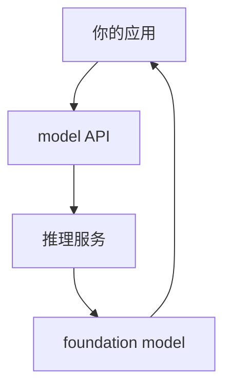

## Q
**Model API · 调用的到底是什么**｜先修 · 必会

你的程序发一个请求，拿回一段回答，按用量付费。这条链路里有哪几个角色？账单按什么算？

## A
**一句话：** 模型放在别人的服务器上运行，对外只露出一个接口，这个接口叫 **model API**；跑模型并响应请求的服务叫 **inference service**（inference：用模型算出输出）。

**谁提供 API：**
- 模型厂商（如 OpenAI、Anthropic）；
- 云厂商（如 Azure、GCP）；
- 第三方推理服务（如 Databricks Mosaic、Anyscale）。

同一个模型可以从不同 API 访问，功能、限制、价格不同，性能也可能有细微差异（各家做的优化不同）。换 API 时要重新测。

**计费：** 按 token 收费，输入和输出的 token 越多越贵；所以很多应用想办法减少输入输出的 token 数。API 的单价基本不随你的规模变化，而自己托管模型的单价会随规模下降。

**接口趋同：** 很多模型厂商模仿最流行的那套 API，所以换模型相对容易；但每个模型各有脾气，提示词和数据还是要重新调。

**出处：** Huyen《AI Engineering》ch4 §Open source models versus model APIs；§Cost and Latency；ch1 §Maintenance
