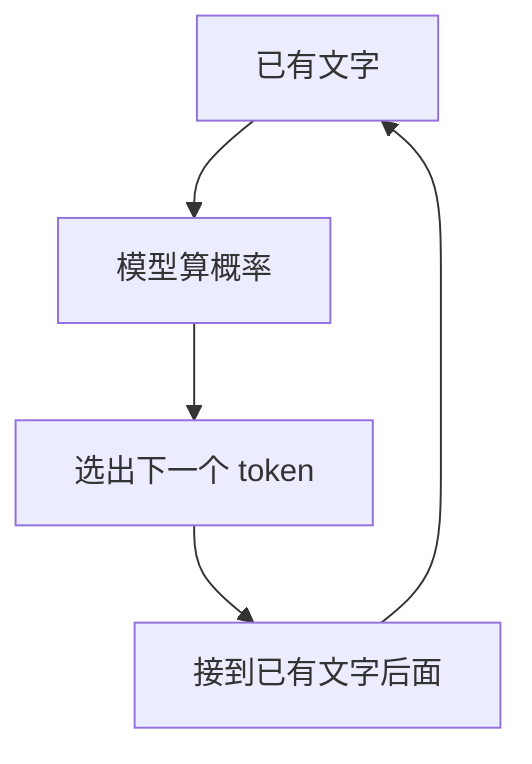

## Q
**LLM · 它到底在做什么**｜先修 · 必会

你在聊天框里输入"法国的首都是"，模型回了"巴黎"。从"一个程序"的角度看，它内部做的唯一一件事是什么？一整段长回答是怎么出来的？

## A
**一句话：** 模型（language model，一个靠大量文字训练出来的程序）每次只做一件事：看已有的文字，**预测下一个 token 是什么**（token 先理解成"一小段文字"，下一张卡细讲）。

- 输出的不是一个答案，而是**每个候选 token 的概率**。比如"我最喜欢的颜色是"后面，"蓝"可能 30%、"红"20%、"车"几乎为 0。
- 选出一个 token，接在后面，整段文字再喂回去预测下一个。一直循环到模型吐出一个"结束"的特殊 token 才停。
- 所以一段长回答 = 许多次"预测下一个 token"首尾相接。这种"只用前面的 token 预测后面"的模型叫 **autoregressive**，今天的文本生成模型几乎都是这一类。

**训练数据从哪来（self-supervision）：** 一句话自己就能同时给出"题目"和"答案"，不用人标注：

| 已有文字（输入） | 要预测的下一个 token |
|---|---|
| `<BOS>` | I |
| `<BOS> I` | love |
| `<BOS> I love` | street |
| `<BOS> I love street` | food |
| `<BOS> I love street food` | . |
| `<BOS> I love street food .` | `<EOS>` |

`<BOS>`、`<EOS>` 是标记开头和结尾的特殊 token；`<EOS>` 让模型学会什么时候停。网上的书、文章、评论都能这样变成训练数据，所以模型能练得很大。

**几个词：**
- **LLM（large language model）：** 很大的 language model。"大"用 **parameter**（模型里在训练中被调整的数字）的个数衡量；今天 1000 亿级算大，这个标准一直在变。
- **prompt：** 你交给模型的、作为"已有文字"的那段输入。
- **completion：** 模型接在 prompt 后面生成的内容。

**出处：** Huyen《AI Engineering》ch1 §Language models、§Self-supervision（Table 1-1）
