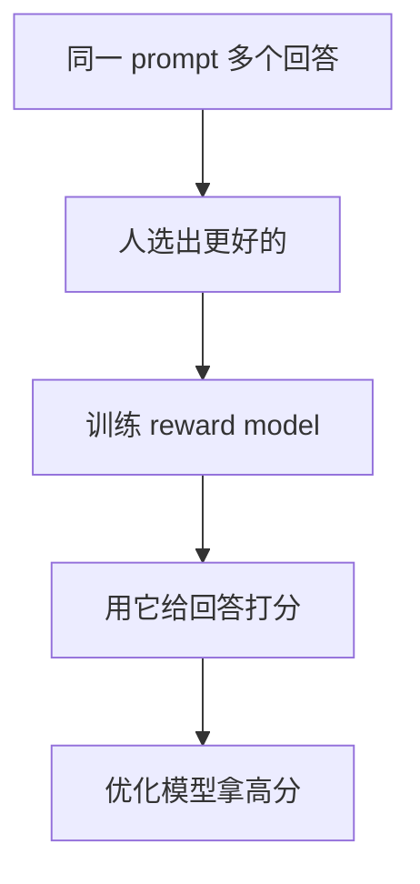

## Q
**Preference finetuning · 为什么让人比较而不是打分**｜先修 · 追问

要教模型"哪种回答更好"，直接让标注员给每个回答打 1–10 分不行吗？RLHF 里是怎么拿到可用数据的？

## A
**问题：** 打分的一致性很差。同一个回答，一个标注员给 5 分、另一个给 7 分，甚至同一个人隔一会儿再打也会变。

**做法：** 改成让标注员**比较两个回答**，选出更好的一个。数据格式是（prompt, winning response, losing response）。比较比绝对打分容易，也更一致。

**RLHF（reinforcement learning from human feedback）两步：**
1. 用比较数据训练一个 **reward model**：输入（prompt, 回答），输出一个分数；训练目标是让赢的回答分数高于输的。
2. 再训练模型，让它生成能被 reward model 打高分的回答（常用强化学习算法 PPO）。

**几个数字：**
- InstructGPT 的标注员排序一致率约 73%：10 个人排同一对回答，约 7 个人排序相同。偏好本来就不统一。
- 比较一对回答要 3–5 分钟（LMSYS），Llama 2 团队每个比较约 3.50 美元，而人写一个回答约 25 美元。

**别的做法：** DPO（Llama 3 用）去掉了 reward model 这一步，更简单；RLAIF 用 AI 而不是人来给反馈。

出处

Huyen《AI Engineering》ch2 §Preference Finetuning（Reward model、Finetuning using the reward model）

