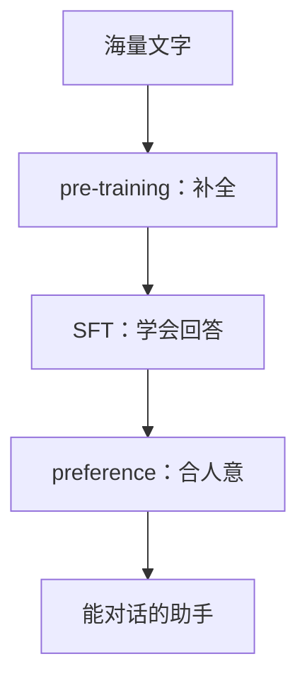

## Q
**Pre-training 与 post-training · 流水线**｜先修 · 必会

刚用海量网页文字训练完的模型，被问"How to make pizza"，为什么可能接一句"for a family of six?"而不是给步骤？要让它变成"听指令的助手"，还要做哪几步？

## A
**问题：** 预训练（pre-training）用"预测下一个 token"训练，目标是补全文字，不是对话；而且数据是从互联网不加区分地收来的，输出可能粗鲁、有偏见或就是错的。

| 阶段 | 用什么数据 | 学到什么 |
|---|---|---|
| **Pre-training** | 海量文字，自监督 | 语言和知识，会补全 |
| **SFT**（supervised finetuning） | demonstration data：（prompt, 理想回答）对，由人写 | 看到问题就给出回答，而不是接着续写 |
| **Preference finetuning** | 人对回答的偏好 | 在能回答的回答里，更偏向人类喜欢的 |

- **Finetuning** 就是在已训练好的 model 上**继续训练**，需要的数据和算力远小于从头训练。
- 模型开发者做的叫 post-training，应用开发者做的叫 finetuning，本质是同一件事。
- 比喻：pre-training 像读书积累知识，post-training 像学会如何使用这些知识。
- 资源占比极不均：InstructGPT 里 pre-training 占约 98% 的算力和数据，post-training 约 2%。

**出处：** Huyen《AI Engineering》ch2 §Post-Training、§Supervised Finetuning；ch1 §On the Differences Among Training, Pre-Training, Finetuning, and Post-Training
