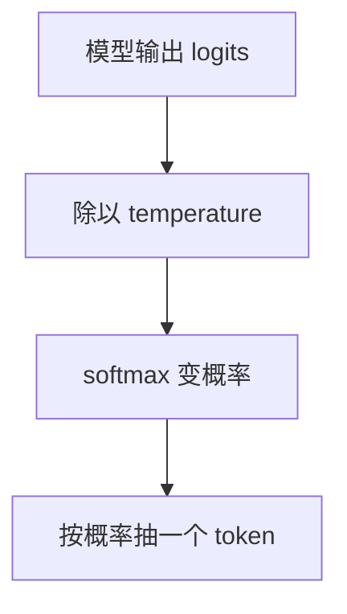

## Q
**Sampling · temperature**｜先修 · 必会

同一个问题问两遍，模型的回答为什么会不一样？模型对下一个 token 给出 logits [1, 2]（A 和 B 两个候选），temperature 从 1 调到 0.5，选到 B 的概率怎么变？

## A
**流程：**

- **logit：** 模型给每个候选 token 的原始分数，词表有多大就有多少个；可以是负数，加起来不是 1，不是概率。
- **softmax：** 把 logits 变成加起来为 1 的概率。
- **greedy sampling：** 永远选概率最高的那个。分类时好用，写文字则单调乏味。所以通常是**按概率抽**：A 50%、B 30% 就按这个比例抽，这就是每次不同的原因。

**temperature：** 先把 logits 除以 T，再做 softmax。

| T | logits 变成 | A 的概率 | B 的概率 |
|---|---|---|---|
| 1（默认） | [1, 2] | 0.27 | 0.73 |
| 0.5 | [2, 4] | 0.12 | **0.88** |

- **T 小：** 更倾向最高分的 token，输出一致但更无趣；
- **T 大：** 冷门 token 机会变大，更有创意但可能不连贯；
- T = 0 实际是直接选 logit 最大的（除以 0 不可能）；模型厂商的 temperature 一般限制在 0–2；创意场景常推荐 0.7 左右，要自己试。

**注意：** 就算 temperature 设为 0，也不保证每次一致，因为运行的硬件不同也会带来差别。

出处

Huyen《AI Engineering》ch2 §Sampling Fundamentals、§Temperature；§Inconsistency（硬件）

