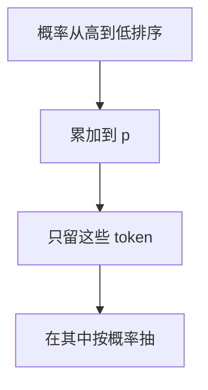

## Q
**Sampling · top-k 与 top-p**｜先修 · 必会

问"你喜欢音乐吗？只回答 yes 或 no"和问"人生的意义是什么？"，应该考虑的候选 token 数量一样吗？top-k 和 top-p 谁能适应这个差别？

## A
**不一样。** 前者只有 2 个合理候选，后者有很多。

| 方法 | 做法 | 候选数 | 典型值 |
|---|---|---|---|
| **top-k** | 只保留 logit 最高的 k 个，在其中抽 | 固定为 k | k 在 50–500 之间 |
| **top-p**（nucleus sampling） | 按概率从高到低累加，加到 p 就停，只在这些里抽 | 随情况变化 | p 约 0.9–0.95 |

**top-p 的例子：** 下一个 token 的概率是 yes 70%、maybe 25%、no 4%、其他 1%。
- p = 0.9：70% + 25% = 95% ≥ 90%，只考虑 yes 和 maybe；
- p = 0.99：加上 no 才达到，考虑 yes、maybe、no。

**区别：**
- top-k 的初衷是**省算力**：softmax 只在 k 个上算，不用对整个词表算。
- top-p 不一定省算力，好处是候选数随上下文变，更贴切。实践中很受欢迎。

**停止条件（stopping condition）：** 可设最大 token 数或 stop token（如结束标记）。设得太早会截断输出：要求输出 JSON 时可能少一个右括号，解析失败。

**出处：** Huyen《AI Engineering》ch2 §Top-k、§Top-p、§Stopping condition（概率数值为说明用的举例）
