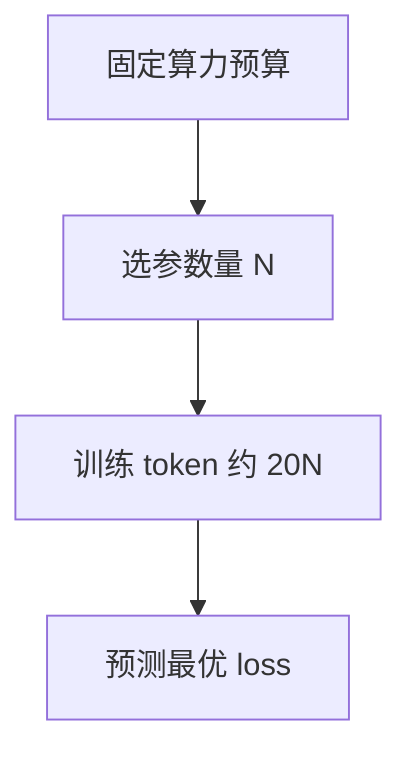

## Q
**Scaling law · 预算固定时怎么分配**｜先修 · 追问

团队只有固定的算力预算，要训练一个模型。是把模型做到最大，还是少做点、多喂数据？为什么主流模型的参数量并不总是预算允许的最大值？

## A
**规则（Chinchilla scaling law，DeepMind 2022）：** 算力（FLOPs）固定时，最优的训练 token 数约为参数量的 **20 倍**；模型翻倍，数据也要翻倍。

| 参数量 | 最优训练 token 数 |
|---|---|
| 3B | 约 60B |
| 6B | 约 120B |
| 70B | 约 1.4T |

对照：Chinchilla 本身 70B 参数、1.4 万亿 token；GPT-3 是 175B 参数、只喂了 3000 亿 token，按这条规则数据偏少。

**但生产里质量不是唯一目标：**
- Llama 的作者选了比预算允许更小的模型，因为小模型推理便宜、好部署，更容易被广泛采用；后续研究（Sardana 等 2023）把推理需求算进了公式。
- 同样质量的成本在下降，但**再提升一点的成本依然很高**：2% 错误率的模型要比 3% 的多一个数量级的数据、算力或电力。

**对做应用的人意味着什么：** 你不训练模型，但这解释了为什么同一家族有多个尺寸，以及为什么「更大」不是唯一的选择标准。

出处

Huyen《AI Engineering》ch2 §Scaling law: Building compute-optimal models；Table 2-5

