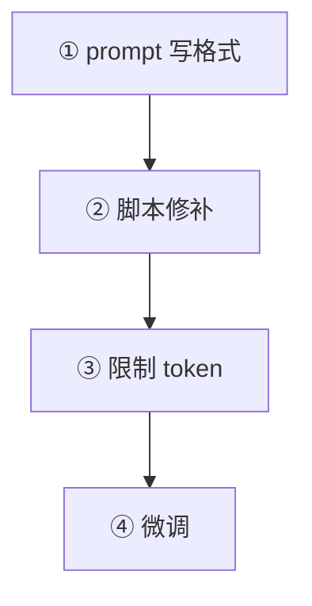

## Q
**Structured outputs · 四层办法**｜先修 · 必会

你的程序要把模型的回复交给下游代码处理，期望是 `{"title": ..., "body": ...}` 这样的 JSON。模型偶尔多写一句"好的，以下是 JSON"，或少一个括号。有哪些办法让输出稳定符合格式？

## A
**为什么需要：** 下游程序、tool（模型能调用的外部函数，比如查数据库） 调用都要能**解析**模型的输出，几个百分点的格式错误在生产里也不能接受。

| 办法 | 做法 | 特点 |
|---|---|---|
| ① Prompting | 在指令里说明格式 | 第一步，但没有保证；可再让一个模型检查，多一次调用 |
| ② Post-processing | 写脚本修常见错误，如补上漏掉的括号 | 便宜；LinkedIn 的容错 YAML 解析器把正确率从 90% 提到 99.99% |
| ③ Constrained sampling | 每一步只在**符合语法的 token** 里抽 | 能保证格式；每种格式要有一套语法 |
| ④ Finetuning | 用符合格式的例子继续训练 | 最通用，比 prompting 可靠，但仍不绝对保证 |

- ①② 像"创可贴"，模型本来就差不多会时才管用；③④ 才是"重治疗"。
- 分类任务还可以在模型后接一个分类头，只能输出预先设定的几类。

出处

Huyen《AI Engineering》ch2 §Structured Outputs（Prompting、Post-processing、Constrained sampling、Finetuning）

