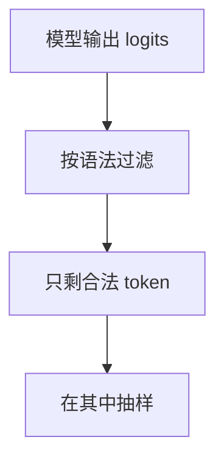

## Q
**Structured outputs · JSON mode 与 constrained sampling**｜先修 · 追问

API 开了 "JSON mode"，线上还是偶尔解析失败，或 JSON 合法但字段是错的。为什么？constrained sampling 是怎么做到"只能产出合法格式"的？

## A
**两个原因：**
- **JSON mode 只保证"是合法 JSON"，不保证内容**：字段对不对、值合不合理，它管不了。
- **输出可能被截断**：生成到最大 token 数就会停，括号没闭合，JSON 就解析不了。设得太小会截断，设得太大又慢又贵。

**constrained sampling 的机制：** 回忆 sampling：模型先给每个候选 token 一个 logit。现在多一步：**把不符合当前语法的 token 的 logit 去掉**，只在剩下的合法 token 里抽。

例：JSON 语法规定 `{` 之后不能再直接接一个 `{`（除非在字符串里），那些 token 在这一步就被排除。

**代价：**
- 每种格式（JSON、YAML、regex、CSV）要有各自的语法，通用性有限；
- 语法检查会增加生成延迟；
- 有人认为这些资源不如用来训练模型更好地服从指令。

出处

Huyen《AI Engineering》ch2 §Structured Outputs（JSON mode、Constrained sampling）

