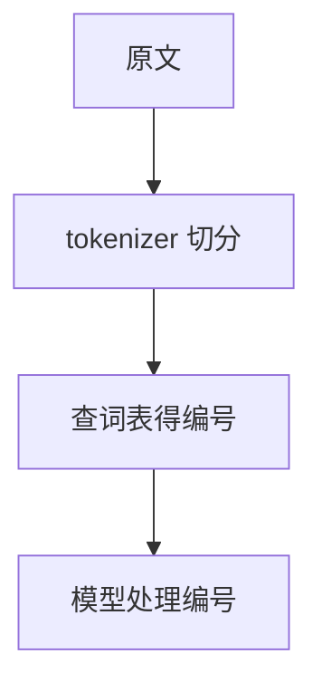

## Q
**Token · 是什么，为什么不用字或词**｜先修 · 必会

模型读写的单位叫 token。一个 token 是一个字、一个词，还是别的？为什么设计成这样？

## A
**一句话：** token 是模型处理文字的最小单位，可能是一个字符、一个词，也可能是词的一部分（如 `-tion`）。把文字切成 token 的过程叫 **tokenization**，由 **tokenizer** 完成。

**例子（GPT-4 的切法）：** `I can't wait to build AI applications` 被切成 9 个 token，其中 `can't` 拆成 `can` 和 `'t` 两个。

**词表（vocabulary）：** 模型认识的全部 token 的集合，由模型开发者决定。Mixtral 8x7B 的词表约 32,000 个；GPT-4 约 100,256 个。

**为什么既不用字符，也不用整词：**

| 单位 | 问题 |
|---|---|
| 字符 | 序列太长，单个字符没有意义 |
| 整词 | 词太多，词表巨大；遇到没见过的新词无法处理 |
| **token（折中）** | 常见词是一个 token，罕见词拆成熟悉的片段 |

- 拆成有意义的部件：`cooking` → `cook` + `ing`。
- 词表比"所有词"小得多，模型更高效。
- 能处理生词：编出来的词 `chatgpting` 可以拆成 `chatgpt` + `ing`，仍能看出结构。

**记住：** 计费、速度、长度上限，下面一律按 **token 数**算，而不是字数或字符数。

**出处：** Huyen《AI Engineering》ch1 §Language models（Figure 1-1 与 Note）
