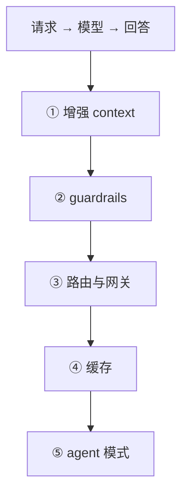

## Q
**应用架构怎么一步步长大 · 实践**｜实践 · 追问

最简单的 AI 应用只有"请求 → 模型 → 回答"。生产里随着需求增加，通常按什么顺序往里加东西？每加一步，换来什么、要警惕什么？

## A

| 步骤 | 加什么 | 为什么 |
|---|---|---|
| ① Enhance context | 外部数据源检索（retrieval，按问题查资料）、工具 | 让模型能用到它没训练过的信息 |
| ② Guardrails | 输入和输出的检查 | 保护系统和用户 |
| ③ Router 与 gateway | 把不同请求分给不同模型；统一的模型入口 | 管理多个模型的复杂度和成本、更安全 |
| ④ Caches | 缓存重复请求的结果 | 降低延迟和成本 |
| ⑤ Agent 模式 | 循环、条件分支、能写入的操作（发邮件、下单） | 能力更强 |

**顺序只是常见路径**，按你应用的需要来。

**代价：** 书里的提醒：系统越复杂，能解决的任务越多，**失败点也越多，更难排查**。所以每一步都应由具体问题推动，并且配上监控与观测。写入类操作（write actions）风险最大，要格外小心。

**出处：** Huyen《AI Engineering》ch10 §AI Engineering Architecture（Step 1–5）
