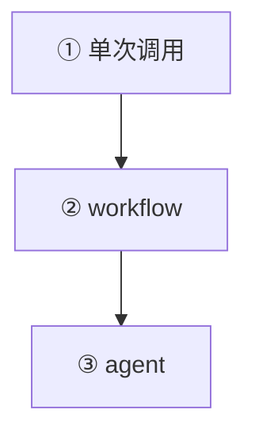

## Q
**Simplest thing first · 三级阶梯**｜摘要 · 必会

同事想一上来就搭一个"agent"来处理工单。从"最简单的办法"出发，一个 LLM 应用从简到繁有哪几级？每升一级换来什么、多付什么？

## A
**一句话：** 先用最简单的办法，**只在评测证明有必要时才加复杂度**。

| 级别 | 是什么 | 换来 | 多付 |
|---|---|---|---|
| ① 单次调用 | 一个 prompt 进、一个回答出；可以加检索来的资料、示例 | 最快、最便宜、最好调试 | 复杂任务可能不够好 |
| ② workflow | **你写死的代码路径**把多次 LLM 调用和工具串起来（顺序、分支、并行） | 步骤可预期，复杂任务更准 | 延迟和成本上升，要维护流程 |
| ③ agent | **模型自己决定**下一步做什么、用什么工具，在循环里自行推进 | 能处理步数无法预先确定的开放问题 | 延迟和成本更高，错误会累积，更难调试 |

- 定义的区别：workflow 里**代码**决定控制流，agent 里**模型**决定。
- 多数应用，优化好单次调用（加检索、加示例）通常就够了。
- 升级的依据是**评测结果**：在你的测试样本上，下一级是否明显更好，而不是"听起来更先进"。
- agent 在每一步要从环境拿到"地面真相"（tool 的返回、代码执行结果）来判断进展，并设停止条件，如最大迭代次数。

出处

Anthropic《Building effective agents》（Workflows vs. agents、When to use agents、Agents）；Huyen《AI Engineering》ch10 §AI Engineering Architecture（从最简架构逐步加组件）

