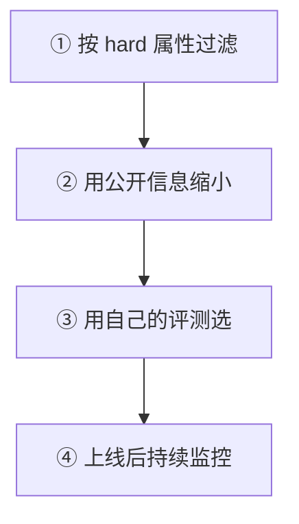

## Q
**Model selection · 选模型的四步流程**｜摘要 · 必会

排行榜上有几十个 model，你的应用该用哪个？有没有一个不靠感觉的流程？"hard attribute"和"soft attribute"有什么区别？

## A
**一句话：** 你要的不是"最好的 model"，而是**对你的应用最好的** model。

| 步骤 | 做什么 |
|---|---|
| ① | 去掉 **hard attributes** 不满足的 model |
| ② | 用公开 benchmark（公开的标准测试集）和排行榜缩小候选，权衡质量、延迟、成本 |
| ③ | 在自己的评测流程上跑实验，选出最合适的 |
| ④ | 上线后持续监控，收集反馈 |

四步可以回头：比如你想自托管开源模型，公开和私有评测后发现达不到要求，就改用商业 API。

**两类属性：**
- **Hard**：你无法或不愿改的，如 license、训练数据、模型大小，或你自己的隐私政策；
- **Soft**：可以改进的，如 accuracy、毒性、事实一致性。

同一属性在不同情况下归类不同：**延迟**如果模型是你自己跑的，是 soft（可以优化）；用别人托管的模型，就是 hard。

**实践：** prompt engineering 阶段先用**最强的模型**验证可行性，再往下试更小的模型；finetuning 则反过来，从小模型开始测试代码，再换大的。

**出处：** Huyen《AI Engineering》ch4 §Model Selection、§Model Selection Workflow
