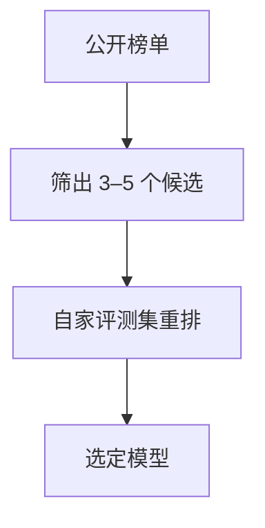

## Q
**Public benchmark · 排行榜回答不了什么**｜摘要 · 必会

候选模型 A 在公开排行榜上比 B 高 3 分，你的任务是做代码生成。能直接选 A 吗？排行榜上的分数是怎么算出来的？

## A
**排行榜是怎么来的：** 先选一组 benchmark，再把各项得分汇总成一个排名。两步都有任意性：

| 选择 | 隐含的假设 |
|---|---|
| 选哪些 benchmark | 榜单上没有代码题，就看不出代码能力 |
| 求平均 | 所有 benchmark 同权重；80% 的 TruthfulQA 和 80% 的 GSM-8K 被当成一样难、一样重要 |
| mean win rate（HELM 的做法：一个模型在各场景里打赢其他模型的比例，再取平均） | 避免直接平均不同量纲的分数 |

- 不同 benchmark 的单位不同：有的用 accuracy，有的用 F1，有的用 BLEU，必须自己决定权重。
- benchmark 之间有相关：Hugging Face 的 Open LLM Leaderboard 旧版里，WinoGrande、MMLU、ARC-C 彼此相关性在 0.87–0.90 之间（2024 年 1 月的计算），而 TruthfulQA 与其他项只有中等相关。说明「推理变强」不等于「更诚实」。
- benchmark 会饱和：榜单每隔不到一年就要换题。

**该怎么用：** 公开榜单只用来**淘汰明显不行的模型、圈出少数候选**；真正选型靠自己的评测集（custom leaderboard：按你的任务挑相关 benchmark，再加你自己的数据）。

出处

Huyen《AI Engineering》ch4 §Navigate Public Benchmarks（Benchmark selection and aggregation、Table 4-5、Custom leaderboards）

