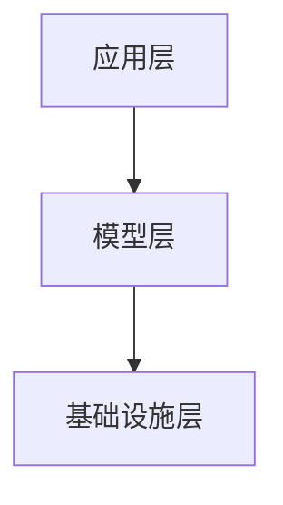

## Q
**AI engineering stack · 三层与它跟传统 ML 的差别**｜摘要 · 必会

你是后端工程师，团队要上线一个基于别人训练好的 model 的应用。AI engineering 的工作分哪三层？它和"自己训练模型"的传统 ML engineering 有哪三点不同？

## A
**三层（从上往下，通常从最上层开始做，需要时再往下）：**

| 层 | 做什么 |
|---|---|
| **应用层** | 给模型好的 prompt 和需要的 context，做 evaluation（评测：判断输出好不好），做用户界面 |
| **模型层** | 训练、finetuning、dataset engineering（整理训练数据）、inference optimization（让模型跑得更快更便宜） |
| **基础设施层** | model serving（把模型作为服务运行）、数据与算力管理、监控 |

**和传统 ML engineering 的三点不同：**
1. **用别人训练好的模型。** 重点从"建模和训练"转到 **model adaptation**（把现成模型适配到你的任务）。
2. **模型更大、更耗算力、延迟更高。** 对 inference optimization 的压力更大。
3. **输出是开放式的。** 好处是一个模型能做很多任务，代价是更难评测，**evaluation 成了更大的问题**。

**适配有两大类：**

| 类别 | 改 weights？ | 特点 |
|---|---|---|
| prompt-based（含 prompt engineering） | 否 | 上手容易，数据少；复杂任务可能不够 |
| finetuning | 是 | 更复杂、数据更多，但质量、延迟、成本可以改善很多 |

**不变的原则：** 仍然要把业务指标映射到技术指标、系统化地做实验、建立用生产数据迭代的反馈回路。不同的是实验的对象变成 model、prompt、retrieval（从资料库里找出相关内容） 方案、sampling 参数这些。

出处

Huyen《AI Engineering》ch1 §The AI Engineering Stack（Three Layers of the AI Stack、AI Engineering Versus ML Engineering）

