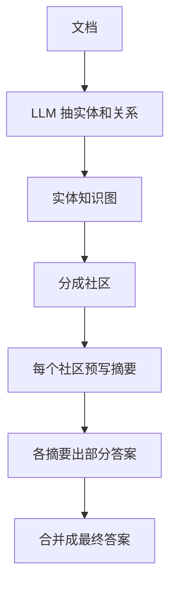

## Q
**Agentic retrieval 与 GraphRAG · 单次检索不够时**｜摘要 · 追问

两类问题让普通 RAG 失灵：①「A 的创始人后来投资的公司是哪家？」要先查一步再查一步；②「这 1 万份文档的主要主题是什么？」没有哪一块能回答。各怎么处理？

## A
**①多跳问题 → agentic retrieval：** 把 retriever 当成一个 **tool** 交给 agent，让它决定查什么、查几次、要不要换关键词再查，根据上一步的结果发下一次查询。

- 代价：每多一次检索就多一次模型调用，延迟和 token 成本增加；要有 **max steps**（最大步数）和预算，避免无限循环。
- 书里把 text retriever、SQL executor、网页搜索都归为「knowledge augmentation」类工具。

**②全局问题 → GraphRAG（Microsoft，2024）：**

- 解决什么：普通 RAG 擅长具体问题，不擅长对整个语料的「全局」问题（本质是针对问题的摘要）；
- 论文在约 100 万 token 的数据集上报告：答案的全面性（comprehensiveness）和多样性比普通 RAG 基线好；
- 代价：**建索引要对全语料跑 LLM 抽取和摘要**，构建成本高，数据更新时要重建相关部分。

**怎么选：** 单点事实 → 普通 RAG；多步推理 → agentic retrieval；全局主题 → GraphRAG，且要问清「建图的成本值不值」。

**出处：** Huyen《AI Engineering》ch6 §Tools → Knowledge augmentation；Edge 等《From Local to Global: A Graph RAG Approach》arxiv.org/abs/2404.16130（2026-11-21 读摘要）
