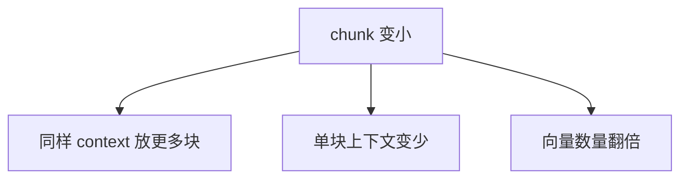

## Q
**Chunking · 块大小的取舍**｜考点 · 必会

团队把 chunk 从 1,000 字符改成 500 字符，想"提高精度"。会发生什么好处？有什么代价？还有什么情况光靠调大小解决不了？

## A
**减半的后果：**

| | 变化 |
|---|---|
| 好处 | 同样的 context 能放下**两倍**数量的 chunk，信息更分散、覆盖面更广 |
| 代价 1 | 一份主题横跨全文的文档，切小后，没被检索到的那一半信息就丢了 |
| 代价 2 | chunk 数量翻倍：要生成的 embedding、要存的向量**也翻倍**，向量搜索空间变大，查询可能变慢 |

**表格、代码、PDF 这类特殊内容：**
- 代码用专门的 splitter（按语法切），问答文档按"一问一答"切；
- 表格数据通常不走"切块 + embedding"，而是转成查询：先把问题转成 SQL（text-to-SQL），执行后把结果交给模型生成回答；
- 块里缺少上下文时，可以给每个 chunk 前面加一段简短说明（文档标题、摘要，或让模型生成的 50–100 token 的定位说明），Anthropic 把这叫 contextual retrieval。

**结论：** 没有通用最佳值。用 retrieval 评测（见检索评测那张卡）比较几个 chunk 大小和 overlap，用数据决定。

**出处：** Huyen《AI Engineering》ch6 §Chunking strategy、§Contextual retrieval、§RAG with tabular data
