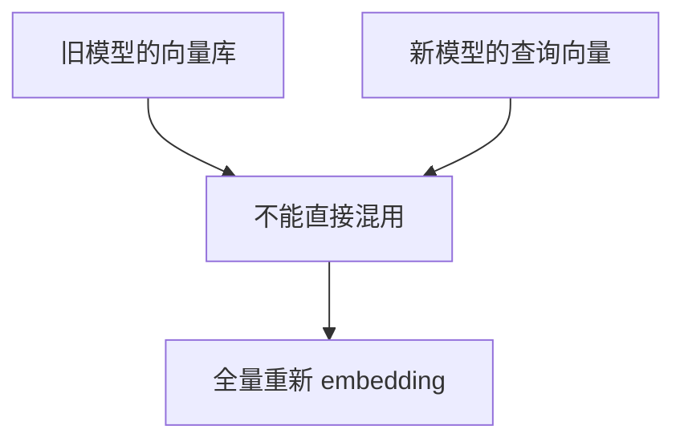

## Q
**Embedding model · 选择与维度**｜考点 · 必会

要为 1 亿个 chunk 建向量索引，候选 embedding 模型一个输出 1,536 维，一个输出 3,072 维。选哪个？这个选择为什么日后很难回头？

## A
**为什么很难回头：** 检索时，**查询用的 embedding 模型必须和建索引时是同一个**。向量空间由具体的模型决定，不同模型的向量不能互相比较。所以**换 embedding 模型 = 把所有 chunk 重新生成 embedding、重建索引**。

**维度的账（计算，按每个数 4 字节 float32 估算）：**

| 维度 | 1 亿个向量的原始大小 |
|---|---|
| 1,536 | 100,000,000 × 1,536 × 4 B ≈ 614 GB |
| 3,072 | ≈ 1,229 GB，是上面的两倍 |

维度翻倍，存储和搜索成本大致跟着翻倍。书里提到：向量库的开销占到模型 API 开销的五分之一甚至一半并不少见；数据常变的话，要频繁重新生成 embedding，每天给 1 亿文档重新生成会非常贵。

**怎么选：**
- 领域匹配、语言覆盖（多语言数据要选多语言的模型）；
- 看通用基准如 MTEB（覆盖检索、分类、聚类），**更要在你自己的检索评测集上比**；
- 输入长度上限要能装下你的 chunk；
- 维度、速度、费用（生成 embedding 要花钱）。

**出处：** Huyen《AI Engineering》ch3 §Introduction to Embedding；ch6 §Embedding-based retrieval、§Comparing retrieval algorithms（成本段）。1 亿 × 维度的存储数是按 float32 的算术结果
