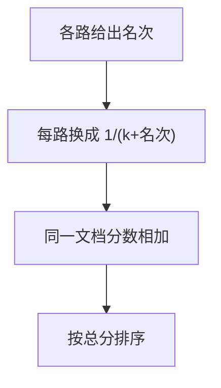

## Q
**Hybrid search · RRF 怎么合并两份排名**｜考点 · 必会

关键词检索和向量检索各返回了一份排名：

| 文档 | 关键词检索的名次 | 向量检索的名次 |
|---|---|---|
| A | 1 | 2 |
| B | 3 | 1 |
| C | 1 | 没出现 |

用 RRF（reciprocal rank fusion）合并，k = 60，最终排序是什么？为什么不直接把两路的分数相加？

## A
**公式：** 每个文档的分数 = 对每一路取 1 ÷ (k + 它在这一路的名次)，再相加；没出现的那一路不加。k 是常数（典型值 60），用来避免除以零和控制低名次的影响。

| 文档 | 计算 | 分数 |
|---|---|---|
| A | 1/61 + 1/62 | **0.0325** |
| B | 1/63 + 1/61 | 0.0323 |
| C | 1/61 | 0.0164 |

**排序：A > B > C。** A 在两路都靠前，B 在一路是第一但在另一路较靠后，只在一路出现的 C 最低。

**直觉版（书里的简化）：** 第 1 名得 1，第 2 名得 1/2，两路相加。同样 A（1 + 1/2 = 1.5）领先。

**为什么用名次而不是分数：** 关键词检索（如 BM25）的分数和向量的相似度**不在同一个尺度上**，没法直接相加；名次没有这个问题，所以 RRF 简单又稳健。

**出处：** Huyen《AI Engineering》ch6 §Combining retrieval algorithms（RRF，k 典型值 60）。上表的名次是出题用的例子，分数是按公式算出
