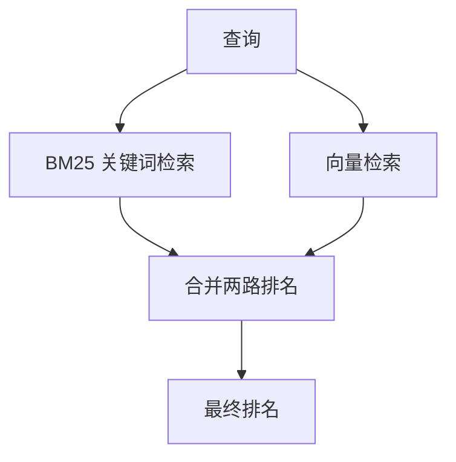

## Q
**Hybrid search · 为什么纯向量会漏**｜摘要 · 必会

用户搜索错误码 `EADDRNOTAVAIL (99)`，纯向量检索却没找到写着这个错误码的文档。为什么？另一种情况，搜 "transformer architecture" 返回了变压器的文档，又是为什么？

## A
两种检索各有短板：

| | Term-based（关键词） | Embedding-based（向量） |
|---|---|---|
| 原理 | 按词匹配，如 BM25、Elasticsearch | 按意思的相近程度 |
| 强项 | 精确词、专有名词、编号；速度快、成本低、开箱即用 | 理解语义，自然语言的问法 |
| 弱点 | 只看字面，不懂意思："transformer architecture" 可能召回电器变压器 | 转成向量后会**淡化关键词**，如错误码、产品名，之后很难按它们搜 |

**BM25 怎么打分（直觉）：** TF-IDF 的改进版。
- **TF**（term frequency）：词在文档里出现越多越相关；
- **IDF**（inverse document frequency）：词出现在越少的文档里越重要，"for"、"at" 几乎每篇都有，信息量低；
- BM25 还按文档长度做归一化，因为长文档更容易出现某个词。
- 用**倒排索引**（词 → 含该词的文档）加速。

**Hybrid search = 两者结合：**
- **串联：** 先用便宜的关键词检索取候选，再用更精确更贵的向量方法找最好的；
- **并联：** 两路各取候选，再把两份排名合并（下一张卡讲 RRF）。

**出处：** Huyen《AI Engineering》ch6 §Term-based retrieval、§Embedding-based retrieval、§Comparing retrieval algorithms、§Combining retrieval algorithms
