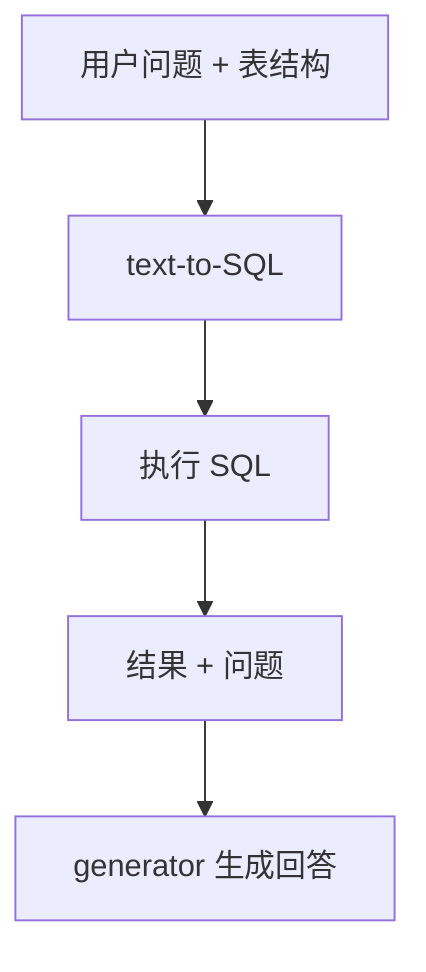

## Q
**Multimodal 与 tabular RAG · 检索不止是文本**｜摘要 · 追问

用户问「上周 Fruity Fedora 卖了多少件？」，数据在订单表里。把表格切成 chunk 再 embedding 行不行？图片怎么检索？

## A
**表格数据：不是检索，而是查询。** 答案要对多行做聚合（SUM、COUNT），向量检索做不了。流程：



```sql
SELECT SUM(units) AS total_units_sold
FROM Sales
WHERE product_name = 'Fruity Fedora'
  AND timestamp >= DATE_SUB(CURDATE(), INTERVAL 7 DAY);
```

- 表很多、schema 放不进 context 时，先加一步预测「这个问题用哪几张表」；
- text-to-SQL 可以由生成最终回答的同一个模型做，也可以用专门的模型；
- 生成的 SQL 是模型输出，执行前要按安全规则校验（只读账号、白名单表）。

**图片等多模态数据：**
- 图片有标题、标签、caption：直接用这些文字元数据检索；
- 要按图片内容检索：用 **multimodal embedding model**（如 CLIP）把文本和图片放进同一个向量空间；步骤：①给所有数据（文本和图片）生成 CLIP embedding 存入向量库；②问题也生成 embedding；③取最近的文本和图片；
- generator 也得是多模态的，才能读图片。

**出处：** Huyen《AI Engineering》ch6 §RAG Beyond Texts（Multimodal RAG、RAG with tabular data）
