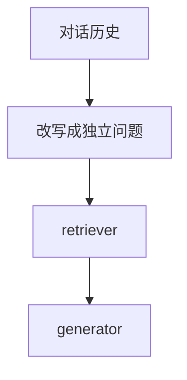

## Q
**Query rewriting · 对话里的追问怎么检索**｜摘要 · 必会

客服 RAG 里，用户先问「John Doe 上次什么时候买过东西？」，得到回答后接着问「那 Emily Doe 呢？」。直接拿这句话去检索会怎样？怎么修？

## A
**问题：** 「那 Emily Doe 呢？」脱离对话就没有意思，用它检索多半拿到不相关的文档。

**做法：** 检索前加一步 **query rewriting**（也叫 query reformulation、query normalization）：让模型根据对话把最后一句改写成**能独立成立**的问题。

改写用的提示词大意：`Given the following conversation, rewrite the last user input to reflect what the user is actually asking.`

改写结果：「Emily Doe 上次什么时候买过东西？」

**要处理的坑：**
- 需要解析指代时（「他太太呢？」），要先查数据库知道她是谁；查不到，改写模型应当承认「无法解决」，而不是编一个名字去检索；
- 每次改写多一次模型调用：增加延迟和成本；
- 改写本身是一个会出错的环节，要单独评测（改写前后检索指标对比）。

**同类做法：** 给每个 chunk 加上下文再索引（contextual retrieval）是在文档一侧补，query rewriting 是在问题一侧补。

出处

Huyen《AI Engineering》ch6 §Query rewriting

