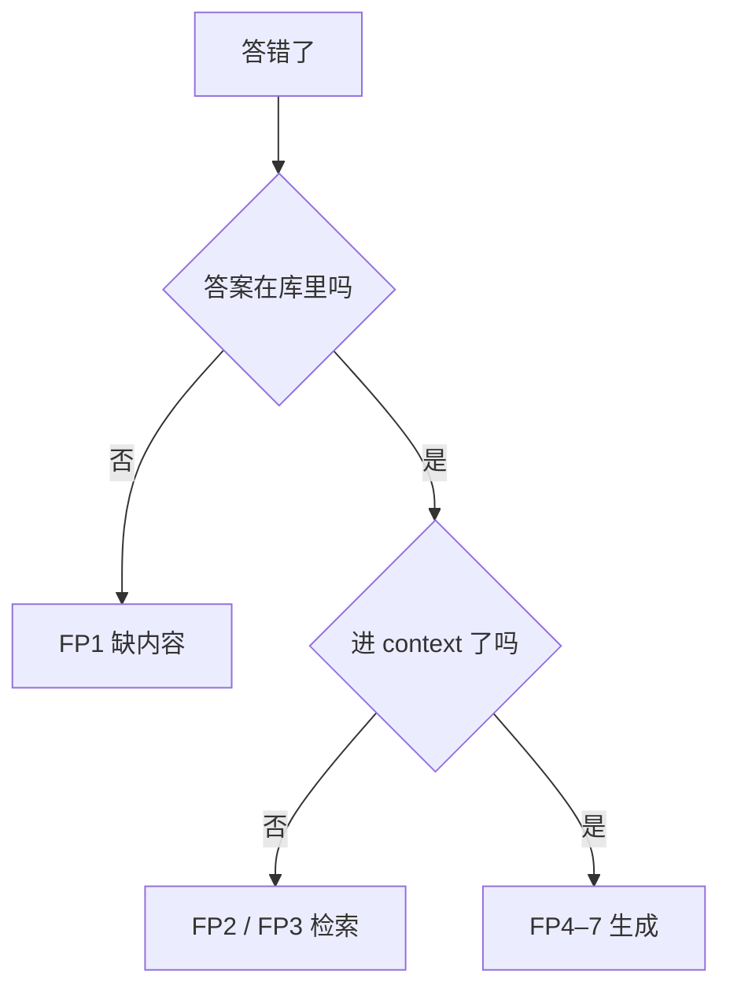

## Q
**RAG failure modes · 七个故障点**｜摘要 · 必会

RAG 机器人对一个问题答错了。你要从哪几处找原因？每一处该怎么修？

## A
Barnett 等（2024）从三个真实项目（研究、教育、生物医学）总结出七个 failure point：

| FP | 现象 | 排查入口 |
|---|---|---|
| 1 Missing Content | 问题文档里根本没有，系统却编了一个答案 | 加「不知道」的约束，检查是否缺资料 |
| 2 Missed the Top Ranked | 答案在文档里，但排名不够靠前，没进 top-K | 改 chunking、hybrid search、reranker |
| 3 Not in Context | 检出来了，但整合时没进最终 context | 看 context 拼接和截断策略 |
| 4 Not Extracted | 答案就在 context 里，模型没提取出来（噪声或互相矛盾的内容太多） | 精简 context、去冲突 |
| 5 Wrong Format | 要表格或列表，模型没照做 | 加格式约束、structured outputs |
| 6 Incorrect Specificity | 太笼统或太细，不合用户需要 | 按用户群调整 prompt |
| 7 Incomplete | 答案对但不全（如「A、B、C 三份文档的要点」） | 拆成分开的子问题 |

**两条经验（论文）：** RAG 系统的**验证只能在运行中进行**；鲁棒性是**逐步演化**出来的，不是一开始设计出来的。

出处

Barnett 等《Seven Failure Points When Engineering a Retrieval Augmented Generation System》arxiv.org/abs/2401.05856，§5（2026-11-21 读全文）

