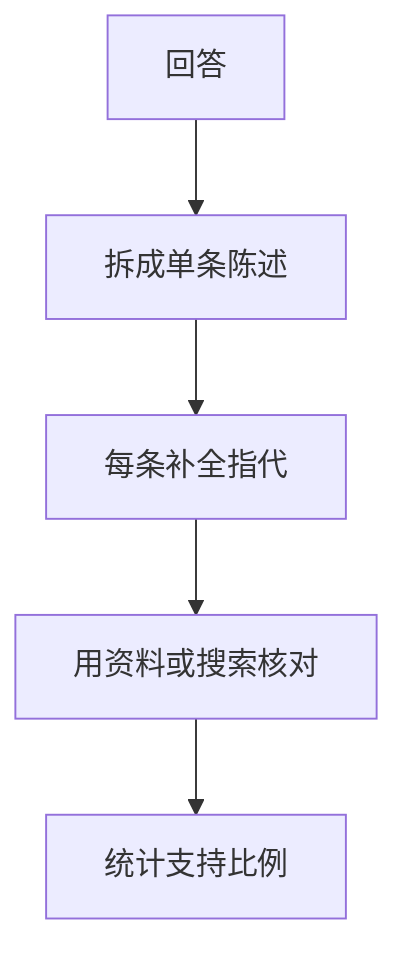

## Q
**RAG 生成端评测 · faithfulness**｜摘要 · 必会

检索回来了正确的政策文档，机器人的回答却多出一条文档里没有的承诺。怎么系统地检测这类问题？

## A
**一句话：** 检查回答是否**只来自给定的资料**，书里叫 **local factual consistency**：输出被给定 context 支持才算一致；与 global（对照公开知识）区分开。资料里说天空是紫色，回答"天空是紫色"算一致，"天空是蓝色"算不一致。

**适用：** 范围有限的任务：摘要（要与原文一致）、客服机器人（要与公司政策一致）、业务分析（要与数据一致）。**对着明确给出的资料验证比对着开放知识容易得多。**

**三种做法：**

| 做法 | 怎么做 | 代价 |
|---|---|---|
| **AI judge**（用另一个模型按标准打分） | 把资料、回答放进 prompt，问"回答里有没有资料不支持的内容？" | 最直接；一次额外调用 |
| **Self-verification**（SelfCheckGPT） | 对同一问题再生成 N 个回答，看原回答与它们是否一致；不一致则很可能是编的 | 要很多次调用，可能很贵 |
| **Knowledge-augmented verification**（SAFE） | 把回答拆成一条条陈述，补全指代，为每条生成搜索查询，用搜索结果判断是否一致 | 需要搜索 |

**设计指标时：** 先分析模型在哪类问题上最容易编（比如冷门知识、问不存在的事情），测试集里多放这类问题。

出处

Huyen《AI Engineering》ch4 §Generation Capability → Factual consistency（local vs global、AI judge、SelfCheckGPT、SAFE）

