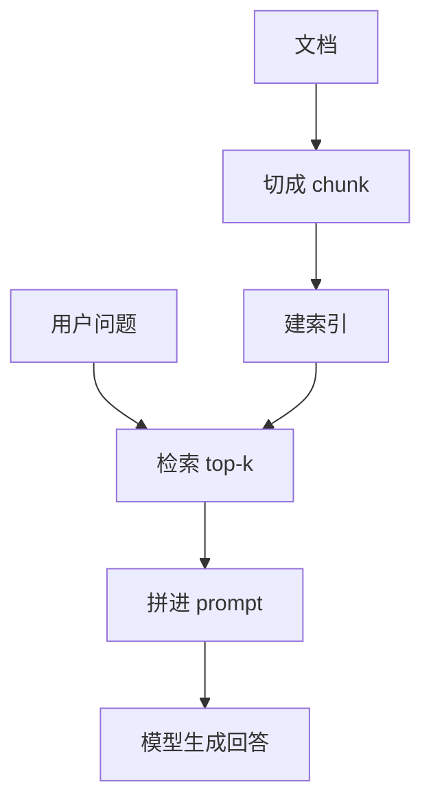

## Q
**RAG pipeline · 全景**｜摘要 · 必会

公司想让客服机器人回答"产品 A300 能不能每分钟打印 100 页"，但模型并不知道这台打印机的规格。RAG 怎么解决？整条 pipeline 有哪几段？

## A
**一句话：** RAG（retrieval-augmented generation）先从外部资料里**检索**（retrieve）出和问题最相关的内容，再把它们放进 prompt 让模型**生成**（generate）回答。相当于为**每个问题单独构造一份 context**。

| 段 | 做什么 | 出错时的表现 |
|---|---|---|
| **Ingestion、chunking** | 读入文档，切成较小的 chunk（文档可能 10 token，也可能 100 万 token，整篇塞进去 context 会无限长） | chunk 切坏，关键信息被切断 |
| **Indexing** | 把 chunk 处理成能被快速查询的形式（比如 embedding 存进向量库、或倒排索引：词到文档的映射表） | 查不到应该查到的 |
| **Retrieval（querying）** | 取出最相关的 k 个 chunk | 取到不相关的，漏掉相关的 |
| **Reranking** | 对候选重新排序（后面单独讲） | 相关的排在后面被截掉 |
| **Generation** | 把检索结果和问题拼成最终 prompt，交给模型 | 模型没用上检索到的内容，或编造 |

- 两个组件：**retriever**（负责 indexing 和 querying）和 **generator**（负责生成）。今天它们通常分别训练，很多团队直接用现成的。
- **每一段可以单独测**。先判断是"检索错了"还是"生成错了"，再下手（见考点卡）。
- 好处：只放与问题相关的信息，能减少 hallucination、减少输入 token 数；也方便只给某个用户放他自己的数据。

**出处：** Huyen《AI Engineering》ch6 §RAG、§RAG Architecture
