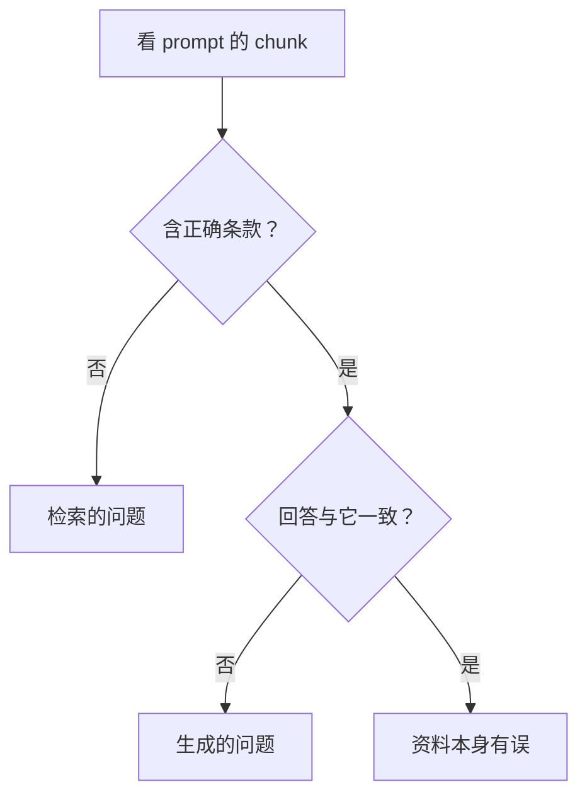

## Q
**RAG pipeline · 先定位是检索错还是生成错**｜考点 · 必会

用户问"退货期限是几天"，RAG 机器人答了"30 天"，但政策文档写的是 14 天。你不改 prompt，也不换 model，先做什么来定位问题？

## A
**先看检索，再看生成。** 把这一次请求的**中间产物**拿出来：最终 prompt 里到底放了哪些 chunk？

| 观察 | 结论 | 下一步查什么 |
|---|---|---|
| prompt 里**没有** 14 天的条款 | 检索错 | chunk 是否把条款切断、embedding 或关键词是否匹配、k 是否太小、排序是否靠后 |
| 有条款，但还放了旧版"30 天"的文档 | 检索回来了冲突资料 | 文档版本、去重、reranking（把检索结果重新排序，后面细讲） |
| 有条款，回答仍是 30 天 | 生成错 | prompt 是否要求"只依据给出的资料"、条款是否埋在很长 context 的中间 |
| 条款本身写的就是 30 天 | 数据源有误 | 数据治理，不是模型问题 |

**为什么这样分：** RAG 系统的成功取决于 retriever 的质量；而每一段都能单独评测。书里的建议是：评测要**逐个组件加端到端**，既评检索（context precision：取回的里相关的比例；recall：相关的里被取回的比例），也评最终回答，对 embedding 模型也单独评。

出处

Huyen《AI Engineering》ch6 §RAG Architecture、§Comparing retrieval algorithms（"the quality of a RAG system should be evaluated both component by component and end to end"）

