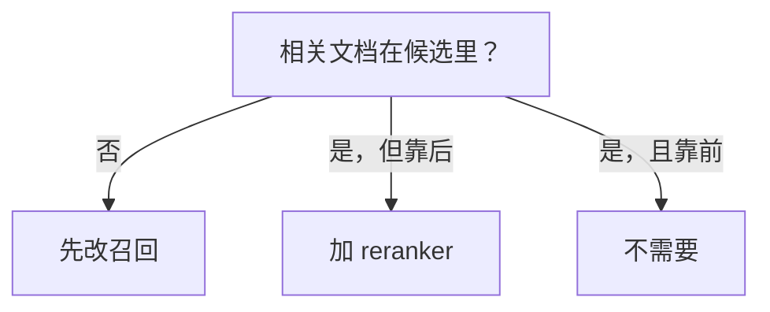

## Q
**Reranking · 加这一级值不值**｜实践 · 追问

团队想在检索后加一级 reranker。怎么判断它值得？它会带来什么新的延迟和成本？

## A
**做法：** 用同一份检索评测集，对比"加 reranker 前后"的指标，再看延迟。

| 看什么 | 怎么看 |
|---|---|
| 质量 | 检索指标（precision（找回的结果里有多少是相关的）、recall（相关的结果里找回了多少）、MRR（第一个相关结果排名倒数的平均）、nDCG（按排名位置加权的相关性得分），定义见检索评测那组卡）是否明显提升；最终回答质量是否提升 |
| 延迟 | reranker 要对每个候选单独打分，候选数越多越慢；总延迟增加多少，用户能不能接受 |
| 成本 | 每个请求多了 N 次（问题，候选）打分的计算 |
| 候选数怎么定 | 召回要广但不是越多越好：候选翻倍，精排成本也翻倍 |

**什么时候收益最大：** 第一段召回的相关文档在候选里，但排名靠后、会被 context 的 top-k 截掉。如果相关文档根本没被召回，reranker 帮不上，要先改召回（chunking、hybrid search、embedding 模型）。

出处

Huyen《AI Engineering》ch6 §Reranking（用途：减少放进 context 的文档数）；sentence-transformers 文档（候选数与逐对打分）

