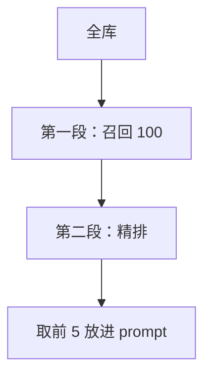

## Q
**Reranking · 召回要广，精排要准**｜摘要 · 必会

向量检索一次取回 100 个候选，但最终 prompt 只放得下 5 个。怎么挑？"cross-encoder"是什么，为什么不直接用它搜整个库？

## A
**两段式：** 第一段便宜、不太精确的 retriever 取一批候选（要广，宁多勿漏）；第二段更精确但更贵的方法对候选**重新打分排序**（reranking），再截取前几个。

**两种打分方式：**

| | Bi-encoder（普通向量检索） | Cross-encoder（精排） |
|---|---|---|
| 做法 | 问题和文档**分别**变成向量，比较相似度 | 把（问题，文档）**一起**送进模型，直接输出相关度分数 |
| 文档向量能否预先算好 | 能，提前建好索引 | **不能**，每个（问题，文档）对都要现算 |
| 准确度 | 较低 | 更高 |
| 规模 | 能搜整个库 | 只适合处理少量候选 |

**所以：** cross-encoder 对全库不现实（sentence-transformers 文档的例子：给 1 万个句子做配对打分约 5,000 万对，要约 65 小时，而 bi-encoder 约 5 秒），所以只用来精排第一段召回的候选。

**其他排序依据：** 对时效敏感的应用（新闻、邮件问答）可以按时间重排，给新数据更高权重。

**注意：** 在检索增强里，名次精确位置不如搜索引擎里那么重要，但顺序仍有影响：模型对 context 开头和结尾的内容理解更好。

**出处：** Huyen《AI Engineering》ch6 §Reranking、§Combining retrieval algorithms；sentence-transformers 文档 Retrieve & Re-Rank / Cross-Encoder（https://www.sbert.net/examples/cross_encoder/applications/README.html）
