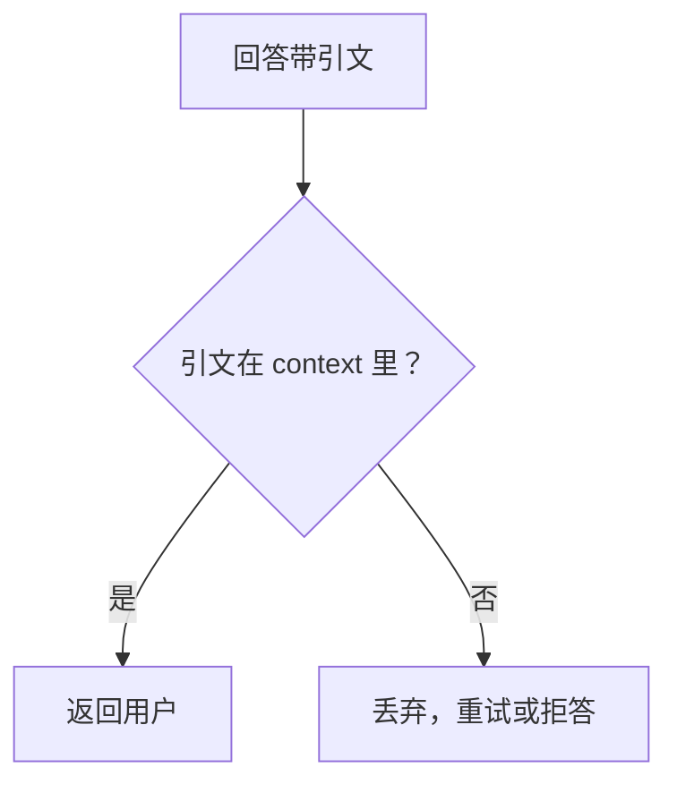

## Q
**限定在 context 内回答 · 能做到多严**｜实践 · 必会

客服机器人只许依据检索到的文档回答，文档里没有就说不知道。怎么实现？提示词写「只能用提供的资料」够不够？

## A
**不够，因为模型不保证遵守所有指令。** 按可靠程度排：

| 手段 | 作用 | 局限 |
|---|---|---|
| 明确指令：「only use the provided context」 | 基本约束 | 不保证遵守 |
| 给**不该回答的问题**的示例，答案是「资料中没有」 | 教会它拒答 | 覆盖面有限 |
| 要求**引用原文出处** | 推动模型只说有依据的话，也便于核对 | 要用代码核对引文真的在 context 里 |
| 在自己的语料上 finetuning | 偏向语料 | 预训练数据仍可能漏进回答 |
| 只用允许的语料从头训练 | 最安全 | 多数场景做不到，语料太小模型质量差 |

**实践：**
- 提示词写拒答话术；引用格式固定，如 `[doc_id: 段落]`；
- 后处理：检查引文是否真在检索结果里，不在就丢弃或重试；
- 用评测衡量：拿一批「文档里没有答案」的问题，统计越界回答率（定义见 faithfulness 那组卡）。

出处

Huyen《AI Engineering》ch5 §How to Restrict a Model's Knowledge to Only Its Context

