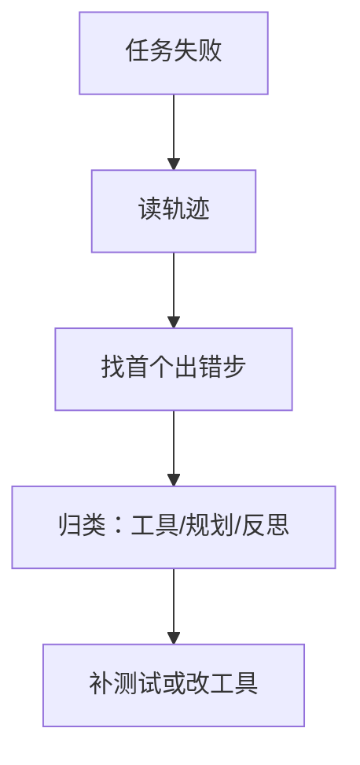

## Q
**Agent 失败 · 每步 95% 成功，二十步后还剩多少**｜考点 · 必会

agent 每一步成功率 95%，任务要 20 步，且前一步错了后面就都错。端到端成功率大约多少？看到这个数字该做什么？

## A
**计算：** 0.95²⁰ ≈ 0.36，即约 **36%**。每步 99% 则 0.99²⁰ ≈ 82%。步数越多，错误越**累积（compounding errors）**。

**书里归纳的失败类型：**

| 类型 | 例子 |
|---|---|
| invalid tool | 计划里用了不存在的 `bing_search` |
| 参数无效 | 工具要 1 个参数，传了 2 个 |
| 参数值错 | 该传 120，传了 100 |
| goal failure | 去了 Ho Chi Minh City 而不是 Hanoi；或超出预算 |
| reflection 出错 | 要给 50 人分 30 间房，只分了 40 人，还说完成了 |
| 时间 | 提案在截止日期后才交 |
| 低效 | 步数、成本、单步耗时超出基线 |

此外还有常见的 loop（重复同一步）、goal drift（偏离原目标）、over-action（做了没要求的事）。

**怎么办：**
1. **从轨迹里定位首个出错步**：先找第一个错，后面多半是连锁反应；
2. 每个工具单独测试，打印每次调用和输出；
3. 统计指标：计划有效率、无效工具调用比例、参数无效比例、平均步数、成本；
4. 缩短链条：把长任务拆开，中间加检查点和人工确认；
5. 加 stop condition 和 max steps（见 agent loop 那组卡）。

出处

Huyen《AI Engineering》ch6 §Agent Failure Modes and Evaluation（Planning failures、Tool failures、Efficiency）；0.95²⁰ 为算术

