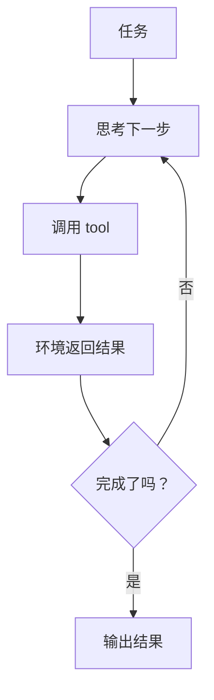

## Q
**Agent loop · 它是怎么转的**｜摘要 · 必会

一个 agent 的运行过程长什么样？为什么说"每一步都要从环境拿到地面真相"？

## A
**定义：** agent 是能**感知环境并对环境做出行动**的东西，由两样东西决定：**environment**（它在哪里运行）和**tools**（它能做的动作）。AI 是"大脑"：处理任务和环境的反馈，规划下一步，判断任务是否完成。

**例（书里的销售预测 agent）：** 要预测下三个月销量。
1. 思考：需要过去五年销量；
2. 调用 SQL 生成，再执行；
3. 思考：数据缺失，还要营销活动信息；
4. 再生成、执行 SQL；
5. 思考：信息够了，给出预测，判断任务完成。

**"地面真相"：** 每一步的 tool 返回结果（SQL 执行结果、代码运行结果）是外部世界的**真实反馈**，agent 靠它判断进展，而不是靠模型自己的想象。没有反馈的循环，就是模型在自说自话。

**核心代价：错误会累积。** 每步 95% 准确，10 步后整体约 60%（0.95^10），100 步后只剩约 0.6%。所以 agent 通常要更强的模型，且步数越多越要有检查。

**出处：** Huyen《AI Engineering》ch6 §Agent Overview；Anthropic《Building effective agents》（Agents：ground truth from the environment）
