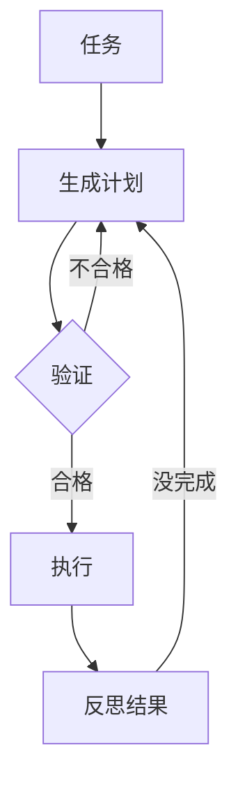

## Q
**Agent planning · planning 与 execution 分离**｜摘要 · 必会

agent 拿到「帮我订两周的旅行，预算 5000 美元」后，一口气生成 1000 步计划就开始执行，跑了几个小时才发现方向不对。怎么改？

## A
**把 planning 和 execution 分开：** 先生成计划，**验证通过再执行**。

**验证计划：**
- 启发式：计划里有 agent 没有的工具就淘汰；超过 X 步就淘汰；
- 用 AI judge 评估计划是否合理；
- 高风险操作（改数据库、合并代码）要人工批准；
- 可并行生成多个计划，由评估器选一个，用更多成本换质量。

**实践要点：**

| 点 | 说法 |
|---|---|
| plan 粒度 | 详细的难生成、易执行；粗的反之。用层级式：先粗计划，再对每步细化 |
| 用函数名还是自然语言 | 用自然语言（「get current date」）更不怕工具改名，但需要一个翻译成命令的步骤 |
| 控制流 | 顺序、并行、if、for；非顺序的更难生成和翻译；选框架时看它支持哪些 |
| intent classifier | 先判意图；超范围的标成 IRRELEVANT，礼貌拒绝，不浪费算力 |
| reflection | 查询后、出计划后、每步后、全部完成后都可反思；**ReAct** 把 Thought / Act / Observation 交替进行 |

**tool selection：** 工具越多越难用好，要通过实验找合适的工具集。

**出处：** Huyen《AI Engineering》ch6 §Planning（Planning overview、Planning granularity、Complex plans、Reflection and error correction）；§Tool selection
