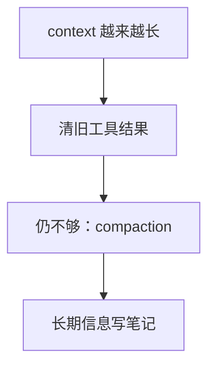

## Q
**Context engineering · 窗口里放什么**｜摘要 · 必会

agent 跑了 40 步，context 里堆满了旧的工具返回，回答开始变差。prompt 没改过。问题出在哪？怎么处理？

## A
**context engineering：** 决定每次调用时放进模型窗口的 token 集合——不只是 prompt，还包括历史、工具返回、检索结果、记忆。原则是用**尽可能少的高信息量 token** 完成任务。

**为什么越多越差：**
- 窗口里的信息不是均匀地被利用：模型对 prompt 开头和结尾的信息理解得比中间好（Liu 等 2023）；
- 上下文越长，越容易盯错地方；每个 token 还多收一份钱、多一点延迟；
- Anthropic 把这种随长度增长而变差的现象叫 **context rot**，说 context 是边际收益递减的有限资源。

**手段（由轻到重）：**

| 手段 | 做法 |
|---|---|
| **tool-result clearing** | 历史里很深处的原始工具输出通常不再需要，直接清掉（最安全、最轻的压缩） |
| **just-in-time retrieval** | 上下文里只放轻量标识（文件路径、查询、链接），需要时再用工具取 |
| **compaction** | 窗口快满时，把对话总结后在新窗口继续；先调到不丢关键信息，再去掉冗余 |
| **structured note-taking** | agent 把进度写进外部笔记文件，之后再读回来 |
| **subagent**（独立窗口里的子 agent） | 让它做搜索，只回传摘要（见 subagent 那张卡） |

**测它：** 用 needle in a haystack 一类测试，看你的任务在多长时才开始掉准确率；掉得早就缩短 prompt。

**出处：** Huyen《AI Engineering》ch5 §Context Length and Context Efficiency；Anthropic《Effective context engineering for AI agents》（2026-11-21 读）
