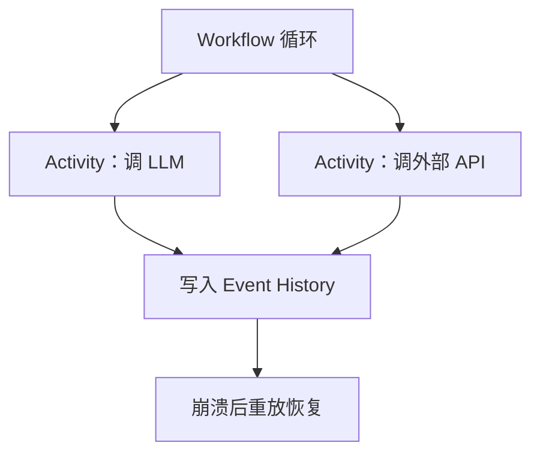

## Q
**Durable execution · 长任务的 checkpoint 与恢复**｜摘要 · 必会

一个 agent 任务要跑 40 分钟，包含 12 次 LLM 调用和若干次外部操作。第 8 步时服务进程崩溃了。没有任何保护，会怎样？durable execution 怎么解决？

## A
**没有保护：** 进程里的状态（已完成哪几步、各步结果）全丢，只能**从头重来**，已经做过的外部操作（发邮件、扣款）可能**再执行一遍**。

**Durable execution：** 把每一步的进展**持久化**。进程崩了，换一个进程**从中断处继续**，局部变量和进度都在。以 Temporal 为例：
- **Workflow：** 写业务流程的控制逻辑（在这里就是 agent 的循环）；
- **Activity：** 一切与外部世界交互的工作（调 LLM、调 API、写数据库、发邮件）；
- **Event History：** 持久的、有序的"发生过什么"的记录，每个步骤完成后写入；
- 崩溃后，新的 Worker 取出这份历史，**重放 Workflow 代码**并跳过已完成的 Activity，重建状态。

**对 agent 的意义：** 长任务、多步骤、有昂贵的 LLM 调用和有副作用的 tool 调用，**不想因为一次故障重做全部**。

**必须配套的两点：**
- Activity 失败会按 Retry Policy 重试，worker 死了会被重新调度，所以 **Activity 可能执行多次，必须幂等**（见幂等键那张卡）；
- Workflow 代码必须是**确定性的**（因为要重放），所以随机、当前时间、调用 LLM 这类不确定的操作要放在 Activity 里。

出处

Temporal 文档 Understanding Temporal（https://docs.temporal.io/evaluate/understanding-temporal）。用它承载 agent 循环是常见的做法，书里无此内容

