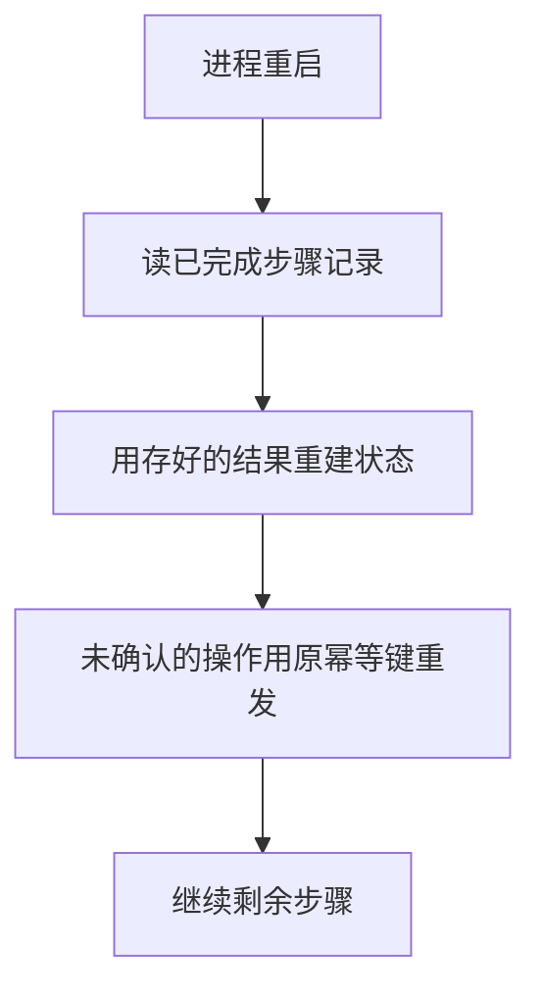

## Q
**Durable execution · 设计检查点**｜考点 · 追问

你要让上面的 agent 能断点恢复，但不用现成的工作流引擎，自己存检查点。每一步要存什么？恢复时怎么避免重复执行有副作用的步骤？

## A
**每个步骤完成后，原子地存一条记录：**

| 存什么 | 为什么 |
|---|---|
| 任务 id、步骤序号 | 知道做到哪里 |
| 该步的输入、LLM 的输出、tool 的返回 | 恢复时**直接使用**，不再重新调用（LLM 也不再重新采样，否则结果会不同） |
| 外部操作的幂等键与状态（待执行、已执行） | 防止重复执行 |
| 累计成本、步数 | max steps、budget 在恢复后仍然有效 |

**恢复流程：**
1. 读取该任务所有已完成步骤的记录；
2. 对每个已完成的步骤，**直接取存好的结果**继续推进；
3. 遇到"已发出但未确认完成"的外部操作，用**同一个幂等键**再发一次，由对方去重；
4. 继续执行剩下的步骤。

**常见错误：**
- 只在最后存结果，中途崩溃全丢；
- 恢复时重新调用 LLM，得到与之前不同的结果，状态分叉；
- 写操作没有幂等键，恢复时重复执行。

**这些麻烦正是 Temporal 这类引擎替你处理的：** 事件历史加重放。是否自己实现，取决于任务长度和故障成本。

出处

基于 Temporal 文档 Understanding Temporal 的事件历史与重放机制（https://docs.temporal.io/evaluate/understanding-temporal）所做的设计推演，书里无此内容

