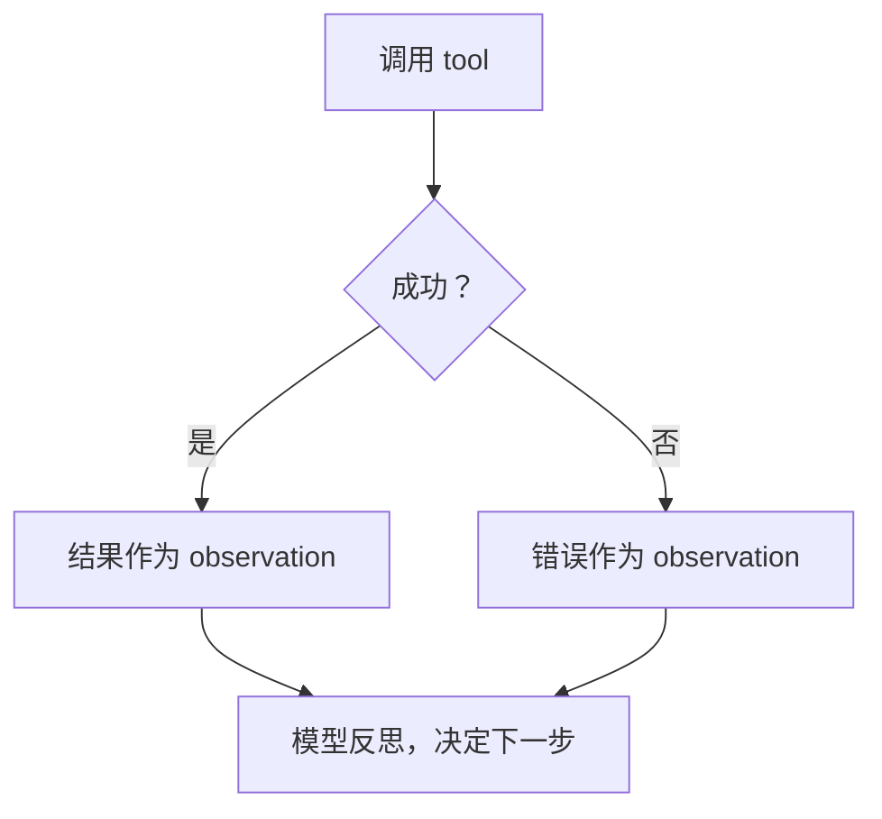

## Q
**Error handling · 把错误当 observation 返回给模型**｜摘要 · 必会

tool 调用失败了（参数不对、接口报错、返回为空）。直接抛异常中止整个 agent，还是别的做法？

## A
**做法：** 把错误信息作为这一步的 **observation**（环境返回的观察结果）交给模型，让它**自己调整**再试。因为 agent 的循环本来就是：行动 → 观察 → 反思 → 新的行动。

**为什么这样：** 反思（reflection）和纠错（error correction）是配套的：反思产生洞察，找出错误，再纠正。书里的例子：代码生成后，评估器发现有 1/3 的测试用例没过；agent 反思出"没考虑数组全为负数的情况"，据此生成新代码。

**错误信息要对模型有用：**

| 差的 | 好的 |
|---|---|
| `Error 500` | `订单 A123 不存在；可用 search_orders 按客户名查找` |
| 空返回 | `没有匹配结果；已搜索范围：2024 年订单` |

- 说清**错在哪、怎么改**；
- 区分**可重试**（超时、限流）和**不可重试**（参数错误、权限不足）；
- ReAct 的格式（Thought / Act / Observation 反复）就是这个循环的写法。

**代价：** 反思会生成大量 token，增加成本和延迟；ReAct、Reflexion 的 prompt 里也要放很多示例。

**出处：** Huyen《AI Engineering》ch6 §Reflection and error correction、§Agent Failure Modes → Tool failures
