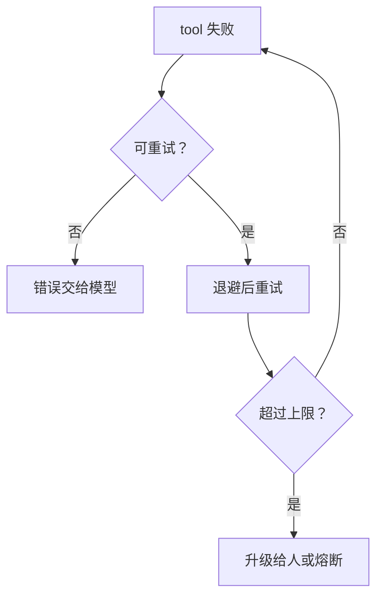

## Q
**Error handling · retry、退避、重复检测、熔断**｜实践 · 追问

某个下游 API 在高峰期偶尔返回 429（限流）或超时。agent 每次都立刻重试，反而让情况更糟。应该怎么设计重试和保护？

## A
| 机制 | 做法 | 防的是什么 |
|---|---|---|
| **只重试可重试的错误** | 429、超时、5xx 重试；参数错误、权限不足不重试，直接交给模型修正 | 无意义的重试 |
| **退避（backoff）** | 重试间隔逐步变长，通常加一点随机抖动 | 大家同时重试把对方压垮 |
| **重试上限** | 最多 N 次，用尽后把错误作为 observation 交给模型或升级给人 | 无限重试 |
| **重复调用检测** | 相同 tool + 相同参数连续失败 ≥ 2 次，就不再原样重试 | agent 陷在同一个错误里 |
| **熔断（circuit breaker）** | 某个 tool 短时间内连续失败，暂时停止调用，快速返回"不可用" | 拖垮整个任务和下游 |
| **幂等** | 会重试的写操作必须带幂等键 | 重复执行 |

**网关层同样做：** 书里提到，模型 API 失败（"不幸很常见"）或被限流时，gateway（统一转发模型请求的中间层）可以路由到备用模型、短暂等待后重试，或优雅降级。

**出处：** Huyen《AI Engineering》ch10 §Gateway（fallback policies）；Anthropic《Building effective agents》（stopping conditions）。退避、熔断是通用的可靠性做法，书里无细节
