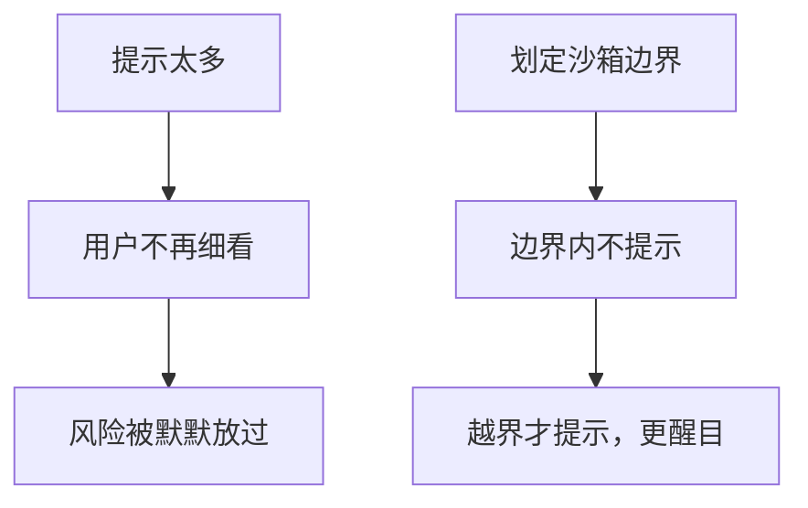

## Q
**Human-in-the-loop · 审批疲劳**｜考点 · 必会

团队为了安全，让 agent 的每一次文件修改和命令执行都弹窗请用户确认。两周后用户都在无脑点"允许"。问题出在哪？怎么改？

## A
**问题：approval fatigue（审批疲劳）。** 请求太频繁，用户不再仔细看自己批准了什么，**安全反而变差**；同时也拖慢了工作。

**怎么改：减少需要批准的次数，而不是加强提示。**
- **划定边界：** 在沙箱（sandbox，把 agent 限制在划定的目录和网络范围内运行）里（文件系统限制在工作目录、网络只能访问批准的服务器），agent 可以**不问**就执行动作；越界才提示。Anthropic 报告，在其内部使用中，沙箱让权限提示**减少了 84%**。
- **文件系统和网络隔离要同时有：** 只有网络隔离，被攻破的 agent 可能逃出沙箱；只有文件隔离，能被用来把文件（如 SSH 密钥）发出去。
- 即使遇到成功的 prompt injection（把恶意指令混进模型读到的内容里），沙箱也能把影响限制在隔离范围内。

**检查你的设计：**
1. 每天弹出多少次？超过用户愿意认真看的次数就是太多；
2. 提示是否说清**具体要做什么、影响什么**；
3. 默认拒绝：用户没回应，就当作没批准；
4. 高风险的动作用更醒目的方式，与普通提示区分开。

**出处：** Anthropic《Claude Code sandboxing》（approval fatigue、84% 为其内部使用的报告数字，页面未给年份）。第 3、4 条是常见的设计做法
