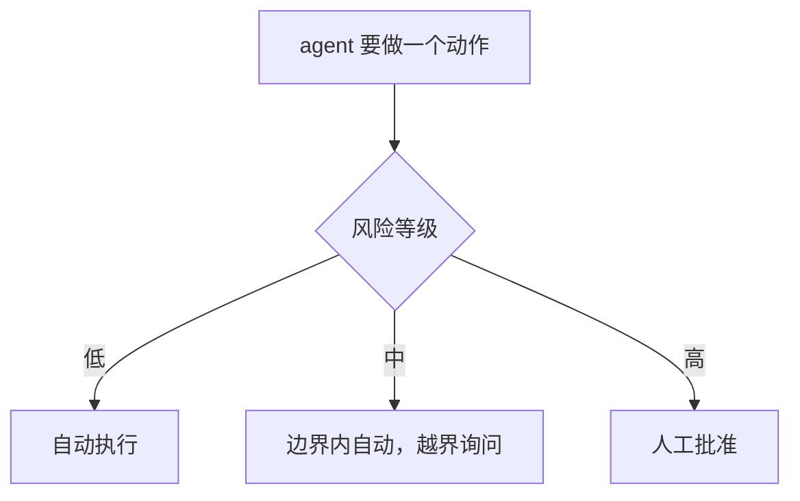

## Q
**Human-in-the-loop · approval 点与 escalation**｜摘要 · 必会

编码 agent 能读文件、改文件、跑命令、联网。哪些动作该让人确认？哪些情况该主动交还给人？

## A
**原则：** 不是每一步都打断人，而是**按风险分级打断**。

| 动作类型 | 默认做法 |
|---|---|
| 只读（读文件、查询） | 自动执行；Claude Code 的默认就是只读，修改和执行命令前要问 |
| 在沙箱（sandbox，限定目录和网络的运行环境）内的写，如改工作目录内的文件 | 在划定的边界内自动执行 |
| 越界动作（访问沙箱外的目录、新的网络域名） | 提示用户决定 |
| 不可逆 / 外部可见（发出、付款、删除） | 必须人工批准 |

**escalation（升级给人）的时机：** agent 在**检查点（checkpoint）或遇到阻碍**时暂停，等待人的反馈（Anthropic）；还有：达到 max steps 或 budget、同一个错误反复出现、任务含糊需要澄清、把握低。

**逐步放权（Crawl-Walk-Run）：**
1. Crawl：必须有人参与；
2. Walk：直接与内部员工交互；
3. Run：更高自动化，可直接面向外部用户。
指标例子：简单请求里 AI 草稿被人原样采用的比例达到 95%，就放开自动回复这一类。

**可撤销设计：** 能撤回的动作，比"先批准后执行"更顺滑；做不到撤回的才必须事先批准。

**出处：** Anthropic《Building effective agents》（Agents：pause at checkpoints or blockers for human feedback）；Anthropic《Claude Code sandboxing》（默认只读、越界提示）；Huyen《AI Engineering》ch1 §The role of AI and humans in the application（Crawl-Walk-Run）
