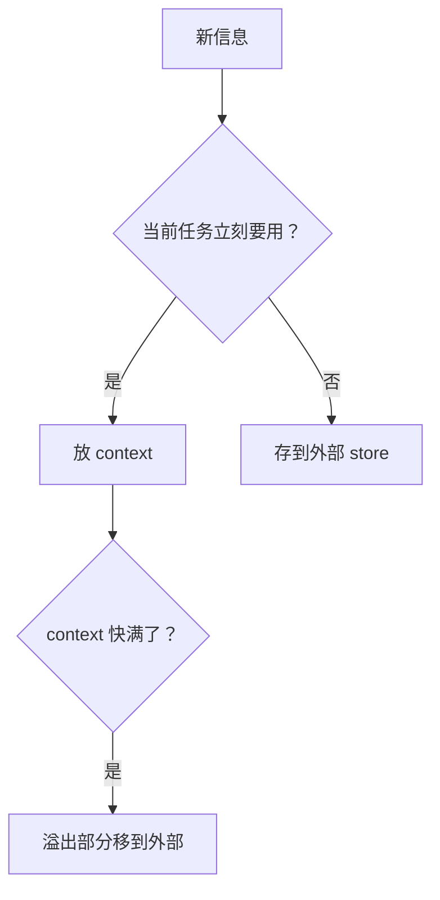

## Q
**Agent state 与 memory · 什么放上下文、什么放外面**｜摘要 · 必会

agent 跑一个长任务，会不断产生新的信息（tool 输出、计划、中间结论）。哪些放进 context，哪些存到数据库？

## A
**模型有三种"记忆"：**

| 记忆 | 在哪里 | 特点 |
|---|---|---|
| **Internal knowledge** | 模型权重里 | 训练时学到的，除非更新模型否则不变 |
| **Short-term memory** | **context** | 访问快，容量有限（受 context length 限制），调用结束就没了 |
| **Long-term memory** | **外部数据源**，通过检索访问（如 RAG） | 可跨任务保存，容量几乎不限，可以不改模型就删除 |

**按使用频率分配：**
- 所有任务都要的信息：通过训练或 finetuning 放进模型；
- 很少用到的：放长期记忆，需要时检索；
- 当前任务的上下文信息：放短期记忆（context）。

**memory 系统的两个函数：**
- **Memory management：** 决定什么存进短期、长期；基本操作是添加和删除；
- **Memory retrieval：** 从长期记忆里取出和任务相关的，与 RAG 的检索类似。

**典型分配：** 假设预留 30% 的 context 给从长期记忆检索来的内容，短期记忆最多用 70%；超过阈值，溢出的移到长期记忆。

**外部存储的另一个好处：** 能保留数据的结构。比如 agent 找销售线索，可以把线索存进一张表，把待办动作存进队列，而不是全塞在 context 的文字里。

出处

Huyen《AI Engineering》ch6 §Memory

