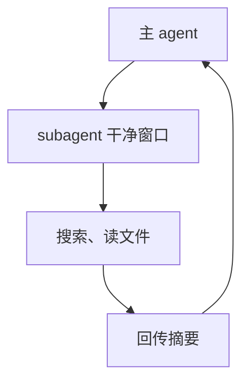

## Q
**Subagent · 用独立窗口做搜索**｜实践 · 追问

主 agent 要在 200 个文件里查某个配置的来源。直接让它自己 grep 会把窗口塞满。怎么用 subagent 解决？它带来什么新问题？

## A
**做法：** 主 agent 把「查清楚这个配置的来源」交给 **subagent**；subagent 在**干净的 context window** 里搜索、读文件、试错，最后只回传一段浓缩的结论（Anthropic 的说法：通常 1,000–2,000 token），主窗口里不留那几十次工具调用的垃圾。

**好处：** 关注点分离；主窗口少污染；多个 subagent 可并行。

**要付出的：**

| 问题 | 对策 |
|---|---|
| 摘要丢细节 | 要求返回带出处的发现（文件、行号） |
| 委派含糊导致重复劳动 | 给目标、输出格式、可用工具、任务边界 |
| subagent 同步执行会阻塞主 agent | 能并行的任务并行派发 |
| 总 token 增加 | 只对确实会污染主窗口的探索任务用 |

**判断标准：** 子任务的中间过程量大、结论量小，才值得隔离。

**出处：** Anthropic《Effective context engineering for AI agents》§Sub-agent architectures；《How we built our multi-agent research system》（2026-11-21 读）
