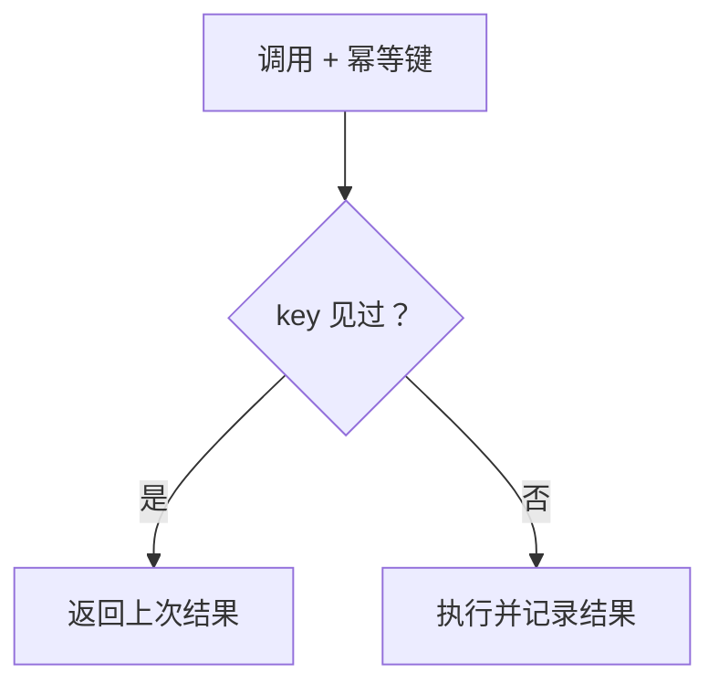

## Q
**Tool · 幂等键**｜考点 · 必会

agent 调用 `create_refund(order_id, amount)`，请求超时了，不知道到底有没有成功。agent 或重试机制又调用了一次。会发生什么？怎么设计 tool，让重试是安全的？

## A
**问题：** 超时只说明"没收到回复"，不说明"没执行"。重试可能执行第二次，客户被**退款两次**。任何会重试的系统（重试策略、工作流引擎重新调度、agent 自己再试一次）都意味着 tool 可能**被执行不止一次**。

**做法：幂等键（idempotency key）。**

```python
# 调用方：同一个业务动作用同一个 key，重试时不变
key = f"refund:{order_id}:{amount}"
create_refund(order_id, amount, idempotency_key=key)

# 服务端：见到同一个 key，不再执行，返回第一次的结果
def create_refund(order_id, amount, idempotency_key):
    done = store.get(idempotency_key)
    if done:
        return done            # 重试：直接返回上次结果
    result = do_refund(order_id, amount)
    store.put(idempotency_key, result)
    return result
```



**要点：**
- key 由**业务动作**决定（哪个订单、哪笔金额），不是每次重试随机生成；
- "检查 key 是否见过"和"执行"要原子地做，不然两个并发重试仍会各执行一次；
- 对天然不幂等的动作（发邮件）先查再发，或把动作改成"幂等地设置状态"；
- 配合上一张卡：不可逆的高风险动作，还要人工确认。

<details class="pt" markdown="1"><summary>出处</summary>

幂等键是通用的工程做法，书里无此内容；Temporal 文档说明 Activity 会被重试、Worker 失败后会被重新调度（https://docs.temporal.io/evaluate/understanding-temporal），因此外部调用必须能承受重复执行

</details>
