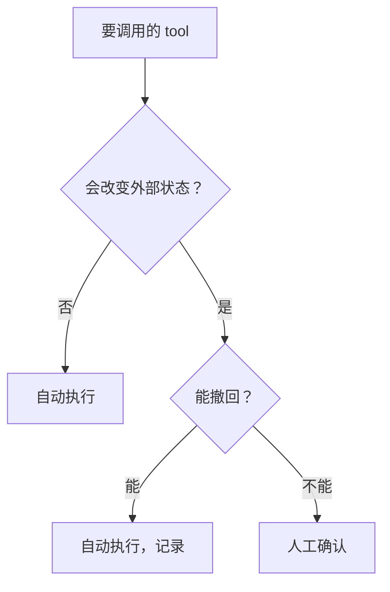

## Q
**Tool 的 side-effect 分级与 permissions**｜摘要 · 必会

给 agent 一批 tool：查订单、发邮件、给客户退款、删除数据库表。它们应该一视同仁地开放给模型吗？按什么分级？

## A
**两大类（书里）：**
- **Read-only actions：** 让 agent 感知环境，如查询、检索；
- **Write actions：** 修改环境，如发邮件、转账、改表、删表。

**实践中把写操作再按"能不能撤回"分开，一共三级：**

| 级别 | 例子 | 默认做法 |
|---|---|---|
| **读** | 查订单、搜索 | 可自动执行，仍要限制能读的范围 |
| **写（可恢复）** | 改草稿、创建工单 | 自动执行，带幂等键（下一张卡），留审计记录 |
| **不可逆 / 高风险** | 发出邮件、转账、删表 | **执行前人工确认**，或根本不开放 |

**书里的态度：** 写操作让系统能做更多（自动跑完整个客户外联流程），但"不要给实习生删生产数据库的权限，也不要让不可靠的 AI 发起银行转账"。要确保系统被保护好，不会被坏人操纵去做有害动作。

**permissions：** 按**最小权限**给：每个 agent 只拿它任务需要的 tool；高风险的 tool 单独授权。（权限范围的设计在安全那一章展开。）

**注：** 上面的三级是工程实践上的归纳，书里只区分读与写。

**出处：** Huyen《AI Engineering》ch6 §Tools（Write actions）；三级分法为通行的工程做法
