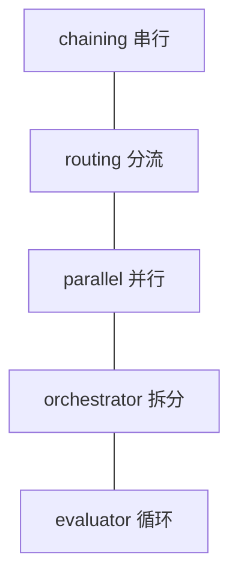

## Q
**Workflow patterns · 五件套**｜摘要 · 必会

Anthropic 把"由代码写死控制流"的 LLM 工作流归成五种基本模式。各是什么？分别适合什么形状的任务？

## A
**前提：** workflow 里是**你的代码**决定先调谁、再调谁（和 agent 里由模型自己决定相对）。下面五种可以组合。

| 模式 | 做法 | 适合的任务形状 | 例子 |
|---|---|---|---|
| **Prompt chaining** | 任务拆成固定的顺序步骤，每步吃上一步的输出，步骤间可加程序化检查（gate） | 能清楚拆成固定子任务；用延迟换准确率 | 先写提纲，检查合格，再写正文 |
| **Routing** | 先把输入分类，送到专门的后续处理 | 有明显不同的类别，各自单独处理更好，且分类可以做准 | 简单问题给小模型，难问题给大模型 |
| **Parallelization** | **Sectioning**：独立子任务同时跑；**Voting**：同一任务跑多次取多样结果 | 子任务能并行提速，或需要多次尝试提高把握 | 一个模型回答、另一个同时审核内容；多个 prompt 各自审查代码漏洞 |
| **Orchestrator-workers** | 中心 LLM 动态拆分任务，分给 worker，再汇总 | **子任务事先无法预知**，由输入决定 | 改多个文件的代码修改、多来源搜索 |
| **Evaluator-optimizer** | 一个 LLM 生成，另一个评价并给反馈，循环 | 有明确的评价标准，且迭代改进有可衡量的收益 | 文学翻译、多轮搜索 |

**区分最容易混的两对：**
- Parallelization 与 orchestrator-workers：前者子任务**预先定好**，后者由输入**动态决定**。
- Routing 与 orchestrator-workers：routing 只选一条路；orchestrator 要拆开、并汇总。

出处

Anthropic《Building effective agents》（Workflow patterns 五种）

