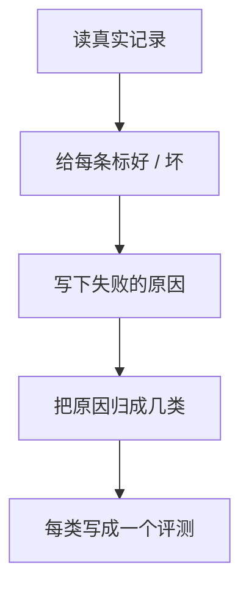

## Q
**Error analysis · 先看数据，再定指标**｜实践 · 必会

你想给对话机器人上评测，同事说"先套几个通用指标：helpfulness、coherence、toxicity"。为什么这样不一定有用？更靠谱的起点是什么？

## A
**问题：** 通用指标不一定对应你的产品**真实在出的错**。你可能得到一个"helpfulness 4.2"，却不知道要改什么。

**更靠谱的做法：从失败里长出评测。**

| 步骤 | 要点 |
|---|---|
| 读数据 | 至少读所有测试用例的记录和真实用户的记录；再持续抽样；读到**不再学到新东西**为止 |
| 标注 | 先用**二元**好 / 坏；比 1–10 打分好管理 |
| 归类 | 开放式地写下每个失败的现象，再归成几类 failure mode（失败模式） |
| 变评测 | 每个常见的失败模式写成一个评测；先从便宜的代码断言做起 |

- **降低看数据的摩擦：** 把每条记录的所有信息放在一个界面里，用你领域的方式展示；可以一天内做出一个简单的查看和标注工具。
- 原则："你永远不能停止看数据"。

**出处：** Hamel Husain《Your AI Product Needs Evals》（Looking at data）；Huyen《AI Engineering》ch4 §Annotate evaluation data
