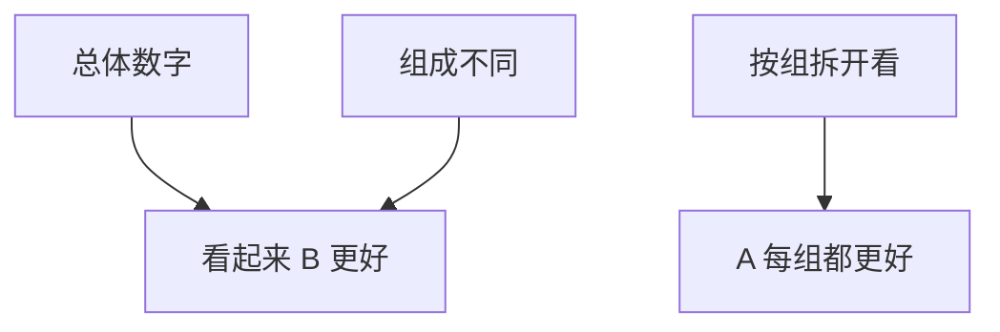

## Q
**Error analysis · 切片与辛普森悖论**｜考点 · 必会

模型 A 和 B 的评测结果如下（括号是答对数 / 总数）。总体看 B 更好，但分组看呢？该信哪个？

| | 组 1 | 组 2 | 总体 |
|---|---|---|---|
| A | 93%（81/87） | 73%（192/263） | 78%（273/350） |
| B | 87%（234/270） | 69%（55/80） | 83%（289/350） |

## A
**分组看：A 在两组都更好**（93% > 87%，73% > 69%），**总体 B 更好**（83% > 78%）。这就是 **Simpson's paradox**：聚合后的结论和每个子集里的结论相反。

**原因：** 两个模型评测的样本**组成不同**。A 被测的多是难的组 2（263 条），B 被测的多是容易的组 1（270 条），所以 B 的总体占了便宜。

**怎么用：** 这就是做 **slicing（切片）** 的理由：按不同属性把数据拆成子集，分别看表现。

| 用途 | 例子 |
|---|---|
| 避免偏见 | 对少数用户群体是否更差 |
| 调试 | 在某类输入（长度、主题、格式）上特别差，原因是什么 |
| 找改进点 | 长输入差，就换处理方式或模型 |
| 避免辛普森悖论 | 比较两个系统时按切片看 |

**评测集的几种切片：** 反映线上分布的总体集；按用户层级（付费 / 免费）或来源（移动 / 网页）；已知常出错的集合；用户常犯错（如拼写错误）的集合；超出范围的输入集。"你在乎什么，就给它一个测试集。"

**出处：** Huyen《AI Engineering》ch4 §Annotate evaluation data（Table 4-6，Simpson's paradox；slicing）
