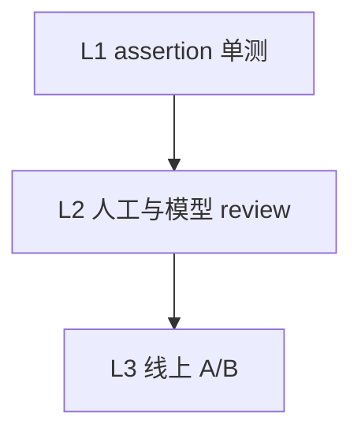

## Q
**Eval 三层 · assertion、review、A/B**｜摘要 · 必会

评测可以很便宜也可以很贵。一个应用的评测通常分哪几层？每层多久跑一次，各抓什么？

## A

| 层 | 是什么 | 频率 | 抓什么 |
|---|---|---|---|
| **L1 assertion** | 像单元测试的断言，用代码判断：输出能否解析、含不含禁用内容 | **每次改动**都跑，快而便宜 | 格式、硬性规则、已知的失败 |
| **L2 human / model review** | 人看记录，或让 LLM judge 按评分标准打分 | 按固定节奏 | 质量、风格、事实性这类要判断的东西；也用来调试 |
| **L3 online A/B** | 把两个版本同时放给不同真实用户，看业务指标 | 重大产品改动后才做，成熟产品才适合 | 对真实用户和业务指标的影响 |

**成本：L3 > L2 > L1。** 顺序：先把 L1 做到一定程度，再做基于模型的评测（它们更费功夫）。

**几个名词：**
- **reference：** 标准答案，用来对照；
- **pairwise 比较：** 给两个回答，判断哪个更好，不打绝对分；
- **rubric：** 评分标准，写明每个分数档对应什么样的回答，最好配例子；
- **A/B testing 与 comparative evaluation 的区别：** A/B 中一个用户一次只看到一个版本的输出，comparative evaluation 让用户同时看到多个。

**混用：** 同一标准可以用两种方法：便宜的分类器对 100% 的数据给粗略信号，贵的 LLM judge 只对 1% 的数据给高质量信号。

出处

Hamel Husain《Your AI Product Needs Evals》（三个 Level）；Huyen《AI Engineering》ch4 §Select evaluation methods、ch3 §Ranking Models with Comparative Evaluation

