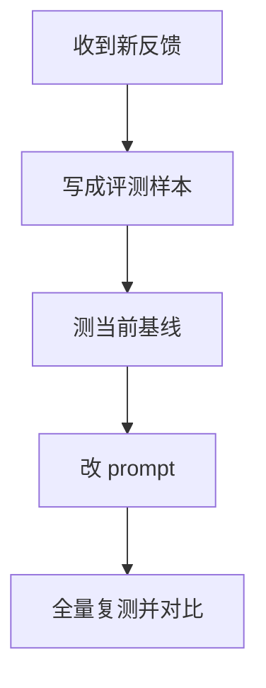

## Q
**evals · 改一处坏一处**｜考点 · 必会

用户反馈"机器人太啰嗦"，你把 prompt 改成"尽量简短"。三天后另一个用户抱怨它回答得太简略、漏了关键步骤。怎么避免这种来回摆动？

## A
**原因：** 你只在一两个例子上看了改动的效果，没有在**一整批有代表性的样本**上测。prompt 的一处改动会影响所有类型的请求。

**做法：**
1. **把两种反馈都变成评测。** 为"啰嗦"和"漏步骤"各写出明确标准和样本（至少几十条真实请求）；
2. **改之前先测基线**：当前版本在这批样本上的各项得分；
3. **改完再测**：新版本在所有标准上的得分，对比；
4. 只有"目标项变好、其他项没变差"才合并；
5. 新出现的失败样本**加回评测集**。

| | 凭感觉 | 有 eval |
|---|---|---|
| 判断依据 | 最近看到的一两条 | 一批样本的各项得分 |
| 改动影响 | 不知道 | 每次都能看到 |
| 回头看 | 无记录 | 每个版本都有分数可比 |

**出处：** Hamel Husain《Your AI Product Needs Evals》（"teams that focus only on changing the system stall at a demo"）；Huyen《AI Engineering》ch4 §Evaluation-Driven Development
