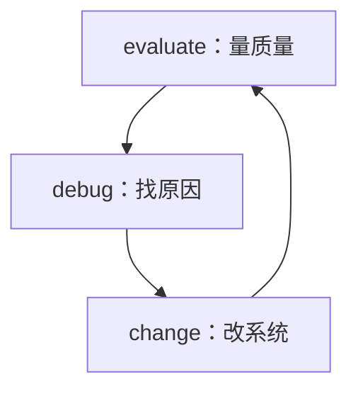

## Q
**为什么 evals 是第一优先级 · 三个循环**｜摘要 · 必会

团队把 LLM 应用做到了能演示，之后每次改 prompt 都靠"感觉变好了"。这样为什么会停在 demo 阶段？一个可持续改进的系统要有哪三个循环？

## A
**一句话：** evals（评测：用一批样本给应用的输出打分）让你知道改动是变好还是变坏。没有它，只能凭感觉改 prompt，**改一处坏一处**还不知道。

| 循环 | 做什么 |
|---|---|
| **Evaluate** | 在一批样本上测当前质量 |
| **Debug** | 看失败样本的完整记录，定位是检索、代码还是模型的问题 |
| **Change** | 改 prompt、finetuning 或代码，再回到 evaluate |

- 只盯着 change 的团队会停在 demo；三件事都做好才形成良性循环。把评测做顺，后两件也更容易。
- 评测流程搭好之后，它产出的数据还能**复用**：合成训练数据、筛选 finetuning 用的数据。

**书里的观点（evaluation-driven development）：**
- 生产里最常见的应用，是**有明确评测标准**的：推荐（看互动或购买率）、欺诈检测（看挽回多少钱）、编码（可以用功能正确性评测）、分类类任务。
- 只做能评测的应用，像"在路灯下找钥匙"，会错过很多难以评测的应用。评测是 AI 落地的最大瓶颈（Huyen 的判断）。
- 应用应从一份**针对该应用的评测标准清单**开始，大类有：领域能力、生成能力（如连贯、忠实）、指令遵循（如格式、长度）、成本与延迟。

出处

Hamel Husain《Your AI Product Needs Evals》（https://hamel.dev/blog/posts/evals/）；Huyen《AI Engineering》ch4 §Evaluation-Driven Development

