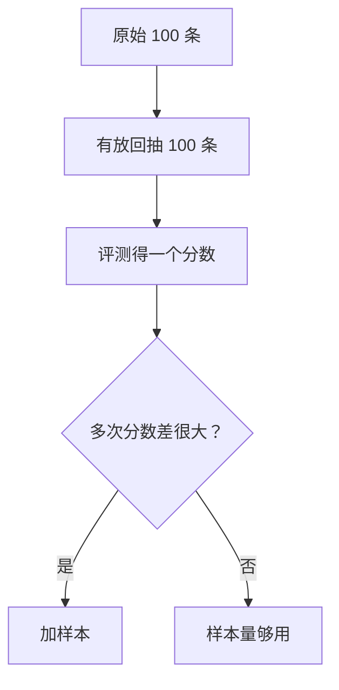

## Q
**Golden set · 要多少条才可靠**｜考点 · 必会

你有 100 条样本。新 prompt 比旧 prompt 高 3 个百分点，能说它更好吗？要确认 1 个百分点的差距，要多少条？怎么检查你这 100 条是否够用？

## A
**OpenAI 给的粗略估计（要有 95% 把握说一个系统更好）：**

| 要检测的差距 | 需要的样本数 |
|---|---|
| 30% | 约 10 |
| 10% | 约 100 |
| 3% | 约 1,000 |
| 1% | 约 10,000 |

**规律：** 差距每缩小 3 倍，所需样本数增加 10 倍。

**回到题目：**
- 100 条只能分辨约 10% 的差距，**3 个百分点的差距在噪声里，不能下结论**；
- 要确认 1 个百分点，约 10,000 条。

**用 bootstrap 检查够不够：**
1. 从 100 条里**有放回**地抽 100 条；
2. 在这 100 条上评测，得到一个结果；
3. 重复很多次；
4. 结果相差很大（有的 90%，有的 70%），说明样本太少，评测不可信，要加样本。

**参考值：** lm-evaluation-harness 的基准里，样本数中位数 1,000、平均 2,159；Inverse Scaling 奖的组织者认为 300 是绝对下限，最好 1,000 以上。评测集要**大到结果可靠，小到跑得起**。

**出处：** Huyen《AI Engineering》ch4 §Annotate evaluation data（Table 4-7，OpenAI 的估计；bootstrap）
